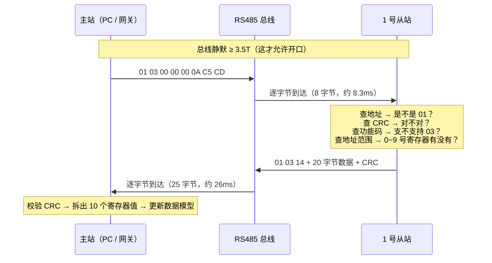
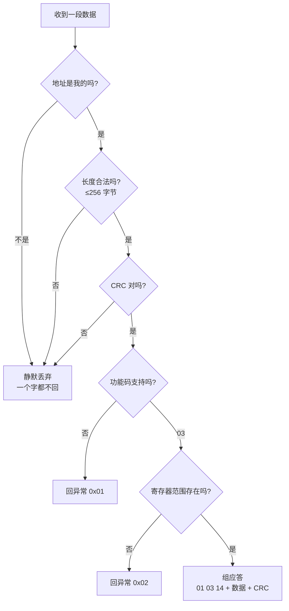

# Modbus 零基础详解（从"串口是什么"讲到能看懂一帧）

> 这篇是给"刚学会 STM32、还没搞清主从机"的人看的。所有术语第一次出现都给一句大白话，不假设你懂任何工业通信。
> 事实与数据以 `01_项目/2026_Modbus边缘采集网关` 和 `H:\Projects\modbus-edge-gateway\docs` 为准；本项目还没实现的部分会明确标"待实现"，不假装做完。

---

## 0. 先给整张地图

你以后会反复听到三个词，它们**不是同一层的东西**：

| 词 | 它到底是啥 | 一句话 |
|---|---|---|
| 串口 / UART | 芯片**内部**的一个外设，负责把"字节"变成"电平跳动"发出去，把"电平跳动"收回成"字节" | 嘴巴和耳朵 |
| RS485 | **电气层**：两根线（A、B）上的电压怎么表示 0 和 1，怎么挂很多设备、怎么抗干扰 | 一根能挂很多人的电话线 |
| Modbus | **协议**：双方说话的规矩（谁先说、第一个字节是什么、说错了怎么回） | 对讲机里的暗号本 |

顺序是：**Modbus（规矩）跑在 RS485（线）上，RS485 由 UART（芯片外设）驱动。**

下面按这个顺序一层一层拆。

---

## 1. 三者关系：串口、RS485、Modbus

### 1.1 生活类比

两个人用对讲机：

- 对讲机本身 = **串口/UART**。它让你能"出声"（发）和"听见"（收）。
- 对讲机之间那根能拉很远、还抗干扰的线 = **RS485**。
- 你们约好的暗号："我先说『一号，报一下温度』，你回『二十三点五』" = **Modbus**。

没有暗号，即使能听见对方声音，也不知道对方在说什么。这就是三层的关系。

### 1.2 技术定义（一层一层来）

**第一层：UART（通用异步收发器）**

STM32 里的 USART1 / USART2 就是干这个的。你给它一个字节（比如 `0x01`），它按约定把字节拆成一位一位的电平，从 TX 脚一位一位"抖"出去；RX 脚上有电平跳进来，它就拼回一个字节给你。

一个字节在线上长这样（8N1 格式，最常用的配置）：

```
空闲(高) ─┐ 起始位 ┌D0 D1 D2 D3 D4 D5 D6 D7┐ 停止位 ┌─ 空闲(高)
           └─0────┴───────────────────────┴───1────┘
```

- "8N1" 读作"8 位数据、无校验（None）、1 位停止"。
- 合计 **10 位**（1 起始 + 8 数据 + 1 停止）。

在 9600 波特率下（9600 表示每秒传 9600 个"位"），一个字节耗时：

```
10 位 ÷ 9600 位/秒 ≈ 1.042 ms
```

这个 1.042ms 请你记住，第 8 节讲 3.5T 要用它。

> 关键点：UART 是**点对点**的。一个 TX 接一个 RX。你想让 10 台设备挂在同一根线上，UART 本身做不到。

**第二层：RS485（电气层）**

它解决 UART 做不到的三件事：

| UART 的短板 | RS485 怎么解决 |
|---|---|
| 单端信号（一根线对地），电压一飘就误判 | **差分信号**：看 A、B 两根线之间的**电压差**，不看去地的绝对电压，干扰同时压在两根线上会被差值抵消 |
| 只能点对点 | **总线**：一根 A、一根 B 挂很多设备（一主多从） |
| 距离短（TTL 通常几十厘米内可靠） | 传得远（百米级，具体看线材与波特率） |

RS485 几个必须知道的名词：

| 名词 | 大白话 |
|---|---|
| A / B 线 | RS485 的两根信号线，靠它俩之间的电压差表示 0 和 1 |
| 差分 | 用"两根线的差"表示信号，而不是"一根线对地的电压" |
| 半双工 | 同一时刻只能一个人说、其他人听，不能说和听同时进行 |
| 终端电阻 | 总线最两端各并一个 120Ω 电阻，吸收信号到线头后的"回音"（反射），线长或波特率高时尤其需要 |
| DE / RE 方向脚 | MAX485 这类芯片上的两个控制脚：DE 拉高 = 我进入发送模式（占用总线），RE 拉低 = 我进入接收模式。半双工就是靠它切换 |

你的项目用的就是 **MAX485（DIP-8 裸片，DE/RE 手动控）**，MCU 用一个 GPIO 决定"我现在是要说，还是要听"。

**第三层：Modbus（协议）**

它规定：总线上谁先说（主站）、说的第一个字节是给谁的（从站地址）、第二个字节是干什么（功能码）、后面跟什么、最后两个字节怎么校验、对方该在第几毫秒内回什么。

### 1.3 一个具体字节的例子

主站要发 `0x01` 这一个字节：

1. Modbus 层决定："这一帧的第一个字节是地址 0x01"。
2. RS485 层决定："把这个字节变成差分电平，A/B 线上差值翻一次算一个 bit"。
3. UART 层决定："按 9600 8N1，1 起始位 + 8 数据位 + 1 停止位，一共 10 位，耗时 1.042ms。"

**同一串 0/1，三层各管一段。** 你在 PC 串口助手里看到的 `01`，是这三层合作的结果。

---

## 2. 主站 / 从站到底是什么

### 2.1 生活类比

老师点名：

- **老师** = 主站。只有老师能开口点名，学生不能自己站起来喊。
- **学生** = 从站。听到自己名字才答"到"，没听到名字就闭嘴。
- 一个班几十个学生 = 一主多从。
- 每个学生有**学号** = 从站地址。

### 2.2 技术定义

| | 主站 | 从站 |
|---|---|---|
| 别名 | Master，也叫 **Client**（客户端） | Slave，也叫 **Server**（服务端） |
| 谁先说话 | 只能它先发请求 | 永远不主动发，只应答 |
| 数量 | 一条总线上**只能有一个** | 一条总线上可以有多个（1–247） |
| 干什么 | 组帧、发送、等应答、超时重试、解析 | 收帧、校验、判断地址是不是自己、执行、组应答 |

规则细节：

- **地址 1–247** 是有效从站地址（248–255 保留）。
- **地址 0 = 广播**：主站发出去，所有从站都执行，但**谁都不许回**（只发不收）。所以广播只能用于"写"，不能用于"读"——你要读数据就必须知道是谁回的。
- **同一时刻只能有一个在说话**：因为 RS485 是半双工，A/B 线是大家共用的。两个设备同时驱动总线，一个想拉高一个想拉低，电平就打架了（电气上叫总线冲突），收方读到的是垃圾。

### 2.3 一个具体例子

主站发 `01 03 00 00 00 0A C5 CD`：

- 地址 `01`：这句话是对 1 号从站说的。
- 2 号、3 号从站听到后：地址不是自己 → **静默丢弃，一个字都不回**（不能回"不是我"，回了就占用总线、打扰别人）。
- 1 号从站听到后：是我的 → 处理 → 回一帧。

这就是"一主多从"的全部秘密：**靠地址在共享总线上点名。**

---

## 3. 为什么需要协议

### 3.1 生活类比

还是对讲机。你朋友在另一头说了一个字："三。"

- 是"读三号寄存器"？
- 是"把三写进去"？
- 是"三号从站"？
- 说完了还是没说完？

**光有声音，没有规矩，信息是不成立的。**

### 3.2 技术定义

没有协议时，MCU 的 RX 引脚上收到的只是一串电平，你拿到的是"一串字节"。你会卡在这几个问题上：

| 问题 | 没有协议时 |
|---|---|
| 从哪开始 | 不知道。可能上一帧的尾巴还没走完 |
| 到哪结束 | 不知道。地址是 1 字节还是 2 字节？数据域多长？ |
| 这是读还是写 | 不知道。没有任何字段说明意图 |
| 读几个 | 不知道。数字 `0A` 是地址还是数量？ |
| 收到的对不对 | 不知道。传错了也照单全收 |
| 对方在不在 | 不知道。发完了永远等，还是多久算超时？ |

Modbus 就是把这 6 个问题一次性回答掉的"暗号本"：

1. **从哪开始**：RTU 规定，总线静默 ≥ 3.5 个字符时间，就认为上一帧结束了、下一帧可以开始了（第 9 节细讲）。
2. **到哪结束**：同样靠静默。RTU 没有帧头帧尾，靠"沉默"当分隔符。
3. **读还是写**：第二个字节是**功能码**，`03` = 读，`06` = 写一个，`16` = 写多个。
4. **读几个**：功能码后面固定跟"起始地址 2 字节 + 数量 2 字节"。
5. **对不对**：最后 2 字节是 CRC16 校验，算不对就整帧丢弃。
6. **在不在**：主站自己设超时，超时就重试、再不行标记该从站离线。

### 3.3 一个具体例子

同一串字节 `01 03 00 00 00 0A`，有协议和没协议的区别：

- **没协议**：6 个不知道含义的数。
- **有协议**：这是"给 1 号从站，读保持寄存器，从 0 号开始，连续读 10 个"的一条完整请求。后面再补 2 字节 CRC，它就是一条可以直接发上总线的帧。

---

## 4. RTU / ASCII / TCP 三种形态

Modbus 有"三个方言"，说的是同一套业务（读寄存器、写寄存器），但**打包方式和走什么线不一样**。

### 4.1 生活类比

同一个意思"帮我拿一下三号柜子的东西"：

- **RTU**：说最快的方言，一个字一个词，语速快、信息密度高。
- **ASCII**：说得慢但清楚，每个字都念全，还带"我开始说了"和"我说完了"的口令。
- **TCP**：不用对讲机了，改用网络电话，中间还加了一层快递单号。

### 4.2 技术对比

| | Modbus RTU | Modbus ASCII | Modbus TCP |
|---|---|---|---|
| 走什么线 | 串口（通常 RS485，也可 RS232） | 串口 | 网口（以太网，TCP/IP） |
| 编码 | **二进制**，一个字节就是一个字节 | **可见字符**，每个字节用 2 个 ASCII 字符表示（如 `0x01` 写成字符 `"01"`） | 二进制 |
| 怎么分帧 | **3.5 字符时间静默**（无帧头帧尾） | 有起始符 `:`，有结束符 `CR LF` | 有 MBAP 报文头（含长度字段），不需要 3.5T |
| 校验 | CRC16（2 字节） | LRC（1 字节，纵向冗余校验） | 通常不带，靠 TCP 自身校验 |
| 效率 | 高（同样数据，字节数最少） | 低（字节数大约翻倍） | 高 |
| 典型场景 | 工业表计、传感器、PLC | 极少，老设备/调试 | 现代 PLC、SCADA、网关上行 |

**为什么你的项目选 RTU：**

1. 现场是"只有 RS485 两根线、没有 IP 能力"的存量设备（温湿度表、电表），这些表出厂默认就是 RTU。
2. RTU 是二进制，同样波特率下传得快；ASCII 要把每个字节写成 2 个字符，传输时间翻倍。
3. RTU 的 3.5T 判帧天然适合"一根总线多从站轮询"的场景，不需要额外的帧头开销。

### 4.3 一个具体例子

同一个 `0x01 0x03` 在两个方言里的样子：

```
RTU  : 01 03 ...            （2 个字节）
ASCII: : 0 1 0 3 ... CR LF  （每个字节变 2 个字符，外加冒号和回车换行）
```

---

## 5. RTU 帧逐字节拆解

这一节是全篇最该背下来的。先看整体：

```
┌────────┬────────┬──────────────────┬──────────────┐
│ 地址   │ 功能码 │     数据域       │    CRC16     │
│ 1 字节 │ 1 字节 │ 0 ~ 252 字节     │   2 字节     │
└────────┴────────┴──────────────────┴──────────────┘
   ↑
   第一字节就是地址，前面没有任何"帧头"
```

**RTU 没有帧头、没有帧尾、没有起始符。** 第一字节就是从站地址。这是新手最容易搞错的地方（详见第 9 节）。

单帧最大 **256 字节**（地址 + 功能码 + 数据 + CRC）。

### 5.1 请求帧逐字节：`01 03 00 00 00 0A C5 CD`

| 偏移 | 字节 | 含义 | 大白话 |
|---|---|---|---|
| 0 | `01` | 从站地址 | 叫 1 号表 |
| 1 | `03` | 功能码 | "我要读保持寄存器" |
| 2 | `00` | 起始地址 **高字节** | 从 0 号寄存器开始 |
| 3 | `00` | 起始地址 **低字节** | （合起来是 `0x0000`） |
| 4 | `00` | 数量 **高字节** | 读 10 个 |
| 5 | `0A` | 数量 **低字节** | （合起来是 `0x000A` = 十进制 10） |
| 6 | `C5` | CRC **低字节** | 校验值 `0xCDC5` 的低 8 位 |
| 7 | `CD` | CRC **高字节** | 校验值的高 8 位 |

三个必须记死的点：

1. **地址和数量都是 2 字节，且高字节在前**（`00 0A` 才是 10，不是 `0A 00`）。
2. **CRC 是低字节在前**：真实 CRC 值是 `0xCDC5`，但发出来是 `C5 CD`。**CRC 的字节序和数据域的字节序是相反的**，这是最容易写错的地方。
3. 整个帧只有 8 字节，耗时 `8 × 1.042ms ≈ 8.33ms`（9600 8N1）。

### 5.2 应答帧逐字节：`01 03 14 <20 字节> <CRC>`

| 偏移 | 字节 | 含义 | 大白话 |
|---|---|---|---|
| 0 | `01` | 从站地址 | 1 号表回的 |
| 1 | `03` | 功能码 | 原样回显"读保持寄存器" |
| 2 | `14` | **字节数**（不是寄存器数！） | `0x14` = 20 字节 |
| 3–22 | 20 字节数据 | 10 个寄存器 × 2 字节 | 每 2 字节 = 1 个寄存器的值 |
| 23–24 | 2 字节 | CRC | 低字节在前 |

**最容易错的一点：应答里的第 3 个字节 `14` 是"数据字节数"，不是"寄存器个数"。**

```
字节数 = 寄存器个数 × 2
0x14 = 20 = 10 个寄存器 × 2
```

整帧长度：

```
1(地址) + 1(功能码) + 1(字节数) + 20(数据) + 2(CRC) = 25 字节
耗时 25 × 1.042ms ≈ 26.0ms
```

还有一个细节：**数据域里每个寄存器的两个字节是"高字节在前"**（和 CRC 相反）。比如某个寄存器值是 `0x0123`，数据域里出现的是 `01 23`。所以一条帧里同时存在两种字节序，必须分清"哪里是数据、哪里是 CRC"。

**读多个寄存器的上限**：03 功能码一次最多读 **125 个寄存器**（250 字节数据），应答最长 `1+1+1+250+2 = 255 字节`。再长就超过 256 字节的帧上限了。

### 5.3 一条完整的对话（时序）



注意：从站收到帧后**不是马上回**，规范要求它先做地址判断、CRC 校验、地址范围检查，都过了才执行并应答。校验不过就**静默丢弃，绝不回**（回一个"我没听懂"会占用总线、打扰其他从站）。

---

## 6. 四种数据区

从站里存的"数据"不是一堆散装变量，而是分成 **4 个区**，每个区有自己的编号习惯。

### 6.1 生活类比

把从站想成一个柜子，有 4 个抽屉：

- 一个抽屉放**开关状态**，你能看也能改（线圈）。
- 一个抽屉放**开关状态，但焊死了只能看**（离散输入）。
- 一个抽屉放**数字，只能看**（输入寄存器）——比如温度测量值。
- 一个抽屉放**数字，能看能改**（保持寄存器）——比如报警阈值。

### 6.2 四个区的定义

| 数据区 | 位宽 | 读 | 写 | 传统编号 | 典型内容 |
|---|---|---|---|---|---|
| **线圈**（Coil） | 1 位 | ✅ | ✅ | 0xxxx | 继电器输出、开关 |
| **离散输入**（Discrete Input） | 1 位 | ✅ | ❌ | 1xxxx | 限位开关、按钮状态 |
| **输入寄存器**（Input Register） | 16 位 | ✅ | ❌ | 3xxxx | 温度、电压等**测量值** |
| **保持寄存器**（Holding Register） | 16 位 | ✅ | ✅ | 4xxxx | 参数、阈值、可写的设定值 |

记忆口诀：**"1 位只能 0/1，16 位能装 0–65535"；"输入"这两个字都表示只读，"保持"和"线圈"都可写。**

### 6.3 八个功能码对应哪个区

| 功能码（十六进制） | 十进制 | 操作 | 作用在哪个区 |
|---|---|---|---|
| `01` | 1 | 读线圈 | 线圈 |
| `02` | 2 | 读离散输入 | 离散输入 |
| `03` | 3 | 读保持寄存器 | 保持寄存器 |
| `04` | 4 | 读输入寄存器 | 输入寄存器 |
| `05` | 5 | 写单个线圈 | 线圈 |
| `06` | 6 | 写单个寄存器 | 保持寄存器 |
| `15`（`0x0F`） | 15 | 写多个线圈 | 线圈 |
| `16`（`0x10`） | 16 | 写多个寄存器 | 保持寄存器 |

规律：**读的 4 个码（01/02/03/04）按"1 位 / 1 位 / 16 位 / 16 位"排列；写的 4 个码里，05 是单线圈、06 是单寄存器、15 是多线圈、16 是多寄存器。**

### 6.4 为什么你的项目用 03 / 06 / 16

- **03（读保持寄存器）**：市面上的 RS485 温湿度模块、电表，测量值基本都放在保持寄存器里（比如 0x0000 起连续几个寄存器 = 温度、湿度）。所以 P0 阶段"单主单从打通"就是发 `01 03 ...`。
- **06（写单个寄存器）**：P3 阶段的"远程写"，比如给某个从站写一个阈值或继电器状态，改动只有一个，用 06 最省字节。
- **16（写多个寄存器）**：要一次连续改好几个参数（比如同时设上下限、延时），一个个发 06 太慢，用 16 一次写完。

> 这三个码现在的真实状态：**03 的应答组帧已实现（含 250 字节上限检查），06 / 16 待实现**。不要以为已经能远程写了。

### 6.5 一个具体例子

`01 03 00 00 00 0A` 这条请求，翻译成人话：

> "1 号从站，读你的**保持寄存器**，从地址 `0x0000` 开始，连续给我 **10 个**。"

如果换成 `01 04 00 00 00 0A`，那就是读**输入寄存器**——虽然只差一个字节，但从站会去另一个抽屉取数据，取出来的值可能完全不同。

---

## 7. 异常响应

### 7.1 生活类比

你问店员："帮我拿一下三号货架第二层的东西。"

店员发现三号货架根本不存在，于是回你："没有这个货架。" —— 这就是异常响应：**我听懂了你的话，但这件事办不到，我告诉你原因。**

### 7.2 技术定义

从站判完请求后，如果**语法没问题但事情办不成**，就回一帧"异常应答"：

```
原功能码 | 0x80  →  异常功能码
后面跟 1 字节异常码
总共 1(地址) + 1(功能码) + 1(异常码) + 2(CRC) = 5 字节
```

功能码"最高位置 1"就是"把功能码加上 `0x80`"：`0x03 | 0x80 = 0x83`。

四个标准异常码：

| 异常码 | 名称 | 什么情况会触发 | 大白话 |
|---|---|---|---|
| `01` | 非法功能 | 功能码不在从站支持列表（比如发 `0x65`） | "我不会干这个活" |
| `02` | 非法数据地址 | 寄存器地址越界（比如表里只有 10 个寄存器，你要读 100 号） | "没有这个格子" |
| `03` | 非法数据值 | 数量或写入值超范围（比如一次要读 200 个） | "这个数量不行" |
| `04` | 从站设备故障 | 从站内部执行失败（传感器坏了、执行时出错） | "我坏了，办不了" |

### 7.3 正常与异常的对照

**正常**（读 10 个保持寄存器）：

```
01 03 00 00 00 0A C5 CD     ← 请求
01 03 14 <20 字节> <CRC>    ← 正常应答（25 字节）
```

功能码是 `03`，一切正常。

**异常**（请求里地址越界，从站回非法地址）：

```
01 03 00 00 00 0A C5 CD     ← 请求
01 83 02 C0 F1              ← 异常应答（5 字节）
```

逐字节看：

| 字节 | 含义 |
|---|---|
| `01` | 1 号从站 |
| `83` | `0x03 + 0x80` → "你这条 03 请求出问题了" |
| `02` | 异常码 02 = 非法数据地址 |
| `C0 F1` | CRC（值 `0xF1C0`，低字节 `C0` 在前） |

**主站侧怎么处理（这条很重要）：**

异常应答是一帧**合法的、CRC 正确的帧**，所以：

- **算通信成功**（不要当丢帧，不要重试到死）。
- **但不更新数据模型**（数据区里不能出现脏值）。
- 连续异常要计入该从站的**健康度统计**（说明这个从站配置错了或寄存器表变了）。

---

## 8. 3.5T 与 IDLE 的区别

这一节是你这个项目最容易做错的技术点，务必分清。

### 8.1 生活类比

- **3.5T** 是**规矩**：暗号本上写着"两个人说话之间，必须安静够 3.5 个字的时长，我才认为上一句结束了"。
- **IDLE** 是**耳朵的一个自动反应**：你听到"安静了大约 1 个字的时间"，脑子就"叮"一下——但"叮"这一下**不代表 3.5 个字的安静已经到了**。

**规矩是 3.5 个字；耳朵只会报 1 个字。** 这就是全部区别。

### 8.2 先算清楚 3.5T 是多少毫秒

一个字符的位数 = 1 起始位 + 数据位 + 校验位 + 停止位。

| 波特率 | 帧格式 | 单字符位数 | 单字符时间 | 3.5T |
|---|---|---|---|---|
| 9600 | **8N1** | 10 | **1.042ms** | **3.65ms** |
| 9600 | **8E1** | 11 | **1.146ms** | **4.01ms** |
| 19200 | 8N1 | 10 | 0.521ms | 1.82ms |
| 115200 | 8N1 | 10 | 0.087ms | 0.30ms |

计算公式：

```
3.5T(ms) = 3.5 × 单字符位数 ÷ 波特率 × 1000
```

举例（9600 8N1）：`3.5 × 10 ÷ 9600 × 1000 = 3.646ms ≈ 3.65ms`

**8E1 比 8N1 多一位校验位**，所以单字符从 10 位变 11 位，3.5T 从 3.65ms 变 4.01ms。这就是为什么"波特率一样"还不够，**校验位也必须一样**（见第 9 节第 5 条）。

补充一条规范细节：波特率高于 19200 时，Modbus over Serial Line 建议把字符间/帧间超时固定取 **1.750ms**，不再按 3.5T 算。实际以所用规范版本和从机兼容性为准，需要实测确认。

### 8.3 IDLE 是什么

STM32 的 USART 有个硬件标志位叫 **IDLE**（空闲）。当 RX 线上**连续一个字符时间没有新数据**时，硬件把 IDLE 置 1，并可以触发中断。

所以 IDLE 的语义是：

> "刚刚安静了大约 **1 个字符**的时间。"

它有三个特点：

| 特点 | 含义 |
|---|---|
| 粒度粗 | 只保证"≥1 个字符"，不保证"≥3.5 个字符" |
| 是硬件自动的 | 不需要你轮询，进中断就行 |
| 只能当信号 | 它本身**不是一个时间长度**，不能直接拿来当"3.5T 到了" |

### 8.4 为什么 IDLE 不能直接当 3.5T

两个原因：

1. **1T ≠ 3.5T**。IDLE 在安静 1 个字符时就触发了，此时 3.5T 的判定条件还差得远。如果你一进 IDLE 就宣布"帧结束"，那么在**逐字节慢发**的场合，一帧会被你拆成好几帧。
2. **IDLE 触发时刻有抖动**。中断响应有延迟，你读到的"时刻"不等于"最后一个字节移出的时刻"，必须用时间戳来量间隔，而不是"进了中断就认为时间到了"。

正确做法（也就是本项目 `docs/02` 里写的那套）：

```
IDLE 中断  →  只做三件事：
              1. 算出这次 DMA 写进缓冲区的区间（当前写位置 - 上次读位置）
              2. 记一个 TIM2 微秒时间戳
              3. 清标志，退出

任务/状态机  →  用时间戳比较：
              本次段结束时刻 - 上次段结束时刻 ≥ 3.65ms ?
              是 → 判为"新的一帧开始"（上一帧结束）
              否 → 合并进同一帧
```

**一句话：IDLE 负责"叫醒你"，TIM2 时间戳负责"量够不够 3.5T"。**

本项目用的是 **TIM2，1µs 分辨率**（16 位计数器软件扩成 32 位微秒计数，所以两次调用间隔不能超过 65ms，否则漏计溢出）。

### 8.5 9600 和 115200 的现实差别

| 波特率 | 3.5T | 用 1ms 系统节拍能分辨吗 |
|---|---|---|
| 9600 8N1 | 3.65ms | 勉强可以（3ms 和 4ms 分得开） |
| 115200 8N1 | 0.30ms | **完全不行**，必须硬件定时器 |

这就是为什么项目强调"判帧不能靠 `HAL_Delay` 凑"，必须有 µs 级定时器。

### 8.6 一个具体例子：一帧被拆成两段

假设从站回了 `01 03 14 ...`，因为 DMA 半满/中断延迟，你的程序看到的是两次"数据段"：

```
段 1: 01 03 14            ← 收到后 IDLE 触发
      ...安静 2ms...        ← 2ms < 3.65ms
段 2: <20 字节数据> + CRC  ← 又一段

正确判定：2ms < 3.65ms → 合并成一帧 → 25 字节 → CRC 校验通过 ✅
错误判定：一进 IDLE 就判帧 → 段 1 只有 3 字节 → 长度不对 → 整帧丢弃 ❌
```

---

## 9. 九条常见误解

每一条都给"错在哪"和"正确的是什么"。

| # | 误解 | 错在哪 | 正确的是什么 |
|---|---|---|---|
| 1 | Modbus 是一种硬件接口 | 它没有规定电压、引脚、连接器；它是**软件协议** | Modbus 是"说话规则"，物理层可以是 RS485、RS232，也可以是 TCP/IP |
| 2 | RTU 帧有帧头（比如 `AA 55`） | RTU **没有帧头、帧尾、起始符**。很多人把别的私有协议的帧头记到 Modbus 上 | 第一字节就是**从站地址**；帧边界靠 **3.5T 静默**界定 |
| 3 | 从站地址是"额外的包装字段" | 它不是附加的，它是**帧的第一个字节**，占 1 字节，没它从站根本不知道该不该理你 | 帧 = 地址 + 功能码 + 数据 + CRC，地址是第一个字段 |
| 4 | CRC 是"数据的一部分" | CRC 是**校验字段**，不是业务数据；而且计算范围**不含 CRC 自身** | 计算覆盖"地址到数据域末尾"；把算出来的 CRC 追加到帧尾后，**对整帧再算一遍应得到 `0x0000`**（这是最快的自检方法） |
| 5 | 从站可以主动上报数据 | Modbus 是严格的**请求-应答**模型，从站没有"主动发"的权利 | 从站只能被动应答。想"上报"，只能靠主站**降低轮询周期**，或者换别的协议（MQTT 等） |
| 6 | 波特率随便设，只要两边一样就行 | 波特率一致只是必要条件。**数据位、校验位、停止位也必须一致**；而且 3.5T 和主站超时都随波特率变 | 必须和从站出厂默认一致（常见 9600 8N1 或 9600 8E1）。改波特率要连判帧阈值、超时预算一起改 |
| 7 | 3.5T 可以用 `HAL_Delay` 精确实现 | `HAL_Delay(3)` 实际是 3~4ms 不定，`HAL_Delay(4)` 又超过 3.65ms；而且它是**阻塞**的，等着的时候别的事全停了；115200 下 0.3ms 根本没法做 | 用**硬件定时器时间戳**（本项目 TIM2 1µs），"记录时刻 + 比较间隔"，而不是"睡一段时间" |
| 8 | IDLE 中断就是"帧结束" | IDLE 只表示"安静了 **1** 个字符"，不是 3.5 个字 | IDLE 只当"可能结束了"的**触发信号**，还要用时间戳确认间隔 ≥ 3.65ms 才算一帧 |
| 9 | 收到字节就处理，不需要缓冲 | 中断里做解析会拖长中断时间、还会和主循环抢数据；高速率下会丢字节 | 中断只做"记录位置 + 投递通知"，解析放任务里；用 DMA + 环形缓冲把"每字节一次中断"降为"每段一次" |

再加一条容易被忽略的：**"应答里的第 3 个字节是寄存器个数"**——错。那是**数据字节数**，等于寄存器个数 × 2（`0x14` = 20 = 10 个寄存器）。这条见 5.2。

---

## 10. 映射到你的项目

你的项目里会出现**三个角色**，别搞混"谁该写哪一半代码"。

| 角色 | 谁在扮演 | 它要做的事 | 需要写哪一侧的代码 |
|---|---|---|---|
| 临时主站 | **PC 测试工具**（`modbus_rtu_tester`） | 手工发帧、控字节间隔、验证板端判帧 | 不用你写，工具已提供 |
| 从站模拟器 | **板子（STM32F103C8T6）** | 收请求 → 校验 → 组应答 | **解包 + 组应答**（从站侧） |
| 真正的网关主站 | **最终网关（STM32 + FreeRTOS）** | 按调度表轮询多个从站 → 超时重试 → 更新数据模型 | **组请求 + 等应答 + 解应答**（主站侧） |

### 10.1 现在处于哪一步

| 项 | 状态（以 docs/02 为准） |
|---|---|
| CRC16 | ✅ 已实现，PC 工具用同一算法交叉验证 |
| 03 响应组帧 | ✅ 已实现，含 250 字节上限检查 |
| USART2 + DMA 循环接收 | ⚠️ 已配置，**尚未启动接收与 IDLE 处理** |
| 3.5T 判帧状态机 | ❌ 待实现 |
| 06 / 16 与异常码 | ❌ 待实现 |

所以现在的实际能力是：**"能从站侧组一条 03 的应答帧"，还不能完整地收帧、判帧、应答。**

### 10.2 "从机模拟器"要写什么

一条请求进来后，从站侧要做 5 件事（顺序不能乱）：



关键顺序：**先判地址（不是我的就别吭声）→ 再判长度 → 再判 CRC → 最后才看功能码和地址范围。** 顺序错了会出现"地址不是我还回了异常帧"这种低级错误（那时候你已经在占用别人的总线了）。

### 10.3 "主机轮询"要写什么

反过来，主站侧要做的 4 件事：

1. **组请求帧**：按轮询表（哪个从站、读哪个地址、读几个）组出 `地址 + 03 + 起始 + 数量 + CRC`。
2. **切方向**：DE 拉高 → 发 → 在"发送完成"中断里拉低 DE（**不能用固定延时替代**，延时随波特率变化就失效）。
3. **等应答 + 超时**：设一个超时值，超时就重试 N 次，还不行就标记该站离线、降频探测，**不能阻塞其他从站**。
4. **解应答**：校验 CRC → 拆数据 → 更新数据模型；如果是异常帧，算通信成功但不更新数据。

超时值怎么定：先测从机最坏应答时间，再叠加收发器方向切换与调度抖动，最后留 20%–30% 裕量。

参考数字（9600 8N1）：8 字节请求约 8.33ms，最长 256 字节应答约 266.7ms —— 所以"宽裕的超时"和"合理的超时"能差一个数量级。

---

## 11. 新手第一周动手清单

**先不写代码**，先把"看得见的东西"建立起来。每一步都给"做对了的现象"。

### 第 1 步：USB-TTL 直连板子（跳过 RS485）

工具 README 里就是这么干的：USB-TTL 直接向板端发 Modbus RTU 报文。

| 项目 | 内容 |
|---|---|
| 接线 | USB-TTL 的 TX → 板子 USART2 的 RX；USB-TTL 的 RX → 板子 USART2 的 TX；**GND 必须共地** |
| 先不做 | 不接 MAX485，不接 A/B 线。这一步只验证**协议层**，不管电气层 |
| 做 | 板子把收到的每个字节用 `printf` 打成 HEX 输出 |
| 做对了的现象 | PC 发 `01 03 00 00 00 0A C5 CD`，板子串口打印出**一模一样的 8 个字节**，不多不少不粘连 |

> 为什么能跳过 RS485：Modbus 是**协议层**，和 A/B 线没关系。先用 USB-TTL 把"字节进得来"跑通，再上 MAX485。这样出问题时你能确定是"协议问题"还是"接线/方向脚问题"。

### 第 2 步：用串口助手看"原始字节"

| 项目 | 内容 |
|---|---|
| 做 | 打开串口助手，切到 **HEX 显示**（不要用文本模式） |
| 做对了的现象 | 能看到 `01 03 00 00 00 0A C5 CD` 8 组十六进制；切到文本模式会看到一堆乱码——**乱码是正常的**，因为这是二进制协议 |
| 顺手验证 | 把 CRC 两个字节对调成 `01 03 00 00 00 0A CD C5` 再发，正确的从站应该**毫无反应**（这是工具里的"② CRC 错误帧"用例） |

### 第 3 步：上 MAX485，量电气层

| 项目 | 内容 |
|---|---|
| 接线 | USART2 TX/RX → MAX485 的 DI/RO；一个 GPIO → DE 和 RE；A/B 接总线 |
| 用万用表量 | ① 空闲时 A、B 之间的**差值**（有偏置电阻时 A 高于 B，差值在几百 mV 量级；没有偏置电阻时可能接近 0 且不确定）；② 发送瞬间差值应该翻转 |
| 不要期望 | 万用表**测不出** 3.65ms 的帧间隔和逐位翻转——它太慢了，只能看"有没有信号、有没有翻转"。要看时序必须用示波器/逻辑分析仪 |
| 做对了的现象 | 不发送时 A/B 有稳定差值；一发送，差值方向变化；DE 拉高期间才发送 |

> 具体电压数值取决于你的偏置电阻和终端电阻，写死一个"标准值"是耍流氓，请以实测为准。

### 第 4 步：写第一个最小函数（CRC16）

| 项目 | 内容 |
|---|---|
| 写什么 | 就一个函数：`uint16_t CRC16(uint8_t *data, uint16_t len)`，多项式 `0xA001`，初值 `0xFFFF` |
| 怎么验 | 算 `01 03 00 00 00 0A`，应得 `0xCDC5`（发送时低字节 `C5` 在前） |
| 做对了的现象 | ① 算出 `0xCDC5`；② 把 `C5 CD` 追加到帧尾后再算整帧，**结果应为 `0x0000`**（这是最快的自检） |
| 常见坑 | 字节序搞反（发成 `CD C5`）；只对数据域算、漏了地址或功能码 |

### 第 5 步：写 03 的应答组帧

| 项目 | 内容 |
|---|---|
| 写什么 | 输入"起始地址 + 数量"，输出 `01 03 14 + 数据 + CRC` |
| 怎么验 | 自己在代码里填死 10 个寄存器值（比如都是 `0x0000`），让板子回一帧，用 PC 工具看 |
| 做对了的现象 | 返回帧长度 **25 字节**；第 3 字节是 `14`；工具端 CRC 校验通过；工具显示"帧合法" |
| 常错 | 第 3 字节写成 `0A`（把寄存器个数当字节数）；数据区里寄存器字节序写反 |

### 第 6 步：加 3.5T 判帧（本周最后一步）

用工具的两个模式交叉验证：

| 模式 | 怎么设 | 做对了的现象 |
|---|---|---|
| 逐字节发送 | 字节间隔 **2ms**（< 3.65ms） | 板子应**合并成一帧**处理（8 字节全收到，校验通过） |
| 逐字节发送 | 字节间隔 **10ms**（> 3.65ms） | 板子应判成**多帧**，每段长度都不合法 → 全部丢弃（**只丢弃，不回应答**） |
| 拆两段发送 | 段间隔 **2ms** | 合并为一帧，正常应答 |
| 拆两段发送 | 段间隔 **10ms** | 判为两帧，都丢弃 |

> 工具限制要知道：USB-TTL 驱动的写入打包粒度通常 **1–16ms**，所以亚毫秒边界（115200 下 3.5T ≈ 0.30ms）**用这个工具卡不准**，那种情况必须板端用定时器自测。

### 第一周不该做的事

| 不做 | 原因 |
|---|---|
| 不接 FreeRTOS | 现在还是裸机 HAL，先把单帧收发跑通；任务划分是目标架构，不是既成事实 |
| 不写 06 / 16 | 06/16 还没实现，先让 03 跑扎实 |
| 不接多个从站 | 一主一从跑通再扩，多从站会引入"谁是罪犯"的排查难度 |
| 不用 `HAL_Delay` 凑判帧 | 见第 9 节第 7 条 |

---

## 术语速查表

| 术语 | 大白话 | 在本项目里对应什么 |
|---|---|---|
| UART / USART | 芯片里"把字节变成电平、把电平变回字节"的外设 | USART1（调试打印）、USART2（接 485） |
| RS485 | 两根线（A/B）靠电压差传数据的总线，能挂多台、抗干扰 | MAX485 裸片 + A/B 总线 |
| 差分 | 看两根线的电压差，不看重对地的绝对电压 | A、B 两线 |
| 半双工 | 同一时刻只能一个说、其他听 | RS485 总线基本特性 |
| DE / RE | MAX485 的方向控制脚：DE 高=发，RE 低=收 | 一个 GPIO 控制方向 |
| 终端电阻 | 总线两端各并 120Ω，吸收信号反射 | 总线两端（线长/高速率时才明显必要） |
| Modbus | 建立在串口/RS485 上的"说话规则" | 协议层全部内容 |
| 主站 / Client | 主动发请求的那一方 | 最终网关；调试期是 PC 工具 |
| 从站 / Server | 只能被动应答的那一方 | 板子（模拟器）；真实场景是温湿度表、电表 |
| 从站地址 | 从站的"门牌号"，1–247；0 是广播 | 板子模拟器用 `01` |
| 广播 | 地址 0，所有从站执行但**都不回** | 只能用于写，不用于读 |
| 功能码 | 帧的第 2 字节，说明"要读还是要写、读哪个区" | 03 / 06 / 16 |
| 保持寄存器 | 16 位、可读可写的数据格 | 03 读、06 单写、16 多写 |
| 输入寄存器 | 16 位、只读的数据格 | 04 读（本项目暂未用） |
| 线圈 | 1 位（0/1）、可读可写 | 01 读、05 单写、15 多写（本项目暂未用） |
| 离散输入 | 1 位、只读 | 02 读（本项目暂未用） |
| CRC16 | 2 字节校验值，算不对就丢帧；**低字节先发** | `CRC16.c`，多项式 `0xA001` |
| 3.5T | 规范规定的"帧间静默 ≥ 3.5 个字符时间"；9600 8N1 下 3.65ms | 判帧阈值 |
| 8N1 / 8E1 | 8 数据位、N 无校验 / E 偶校验、1 停止位 | 必须和从站一致 |
| IDLE | 硬件标志："线路安静了约 1 个字符时间" | 中断里当"可能结束"的触发信号 |
| 异常应答 | 功能码 `| 0x80` + 异常码，共 5 字节 | 01/02/03/04 四个码 |
| 环形缓冲 | 一块首尾相接的缓冲区，写位置绕回 0 继续写 | DMA 循环缓冲 + 读写位置差 |
| 超时预算 | 等一个从站最多等多久，超时就跳过它 | 待实测标定 |
| 轮询 | 按顺序一个个问从站，问完一轮再下一轮 | 网关主站的核心调度 |

---

## 配套阅读

[[教程_2026-11-03_从环形缓冲到Modbus网关]]

---

## 出处

- 项目定位、阶段、硬件、AI 不可代写边界：`01_项目/2026_Modbus边缘采集网关/Modbus边缘采集网关-主档卡.md`
- 分层架构、时序预算、故障隔离：`H:\Projects\modbus-edge-gateway\docs\01-architecture.md`
- RTU 帧结构、CRC16、3.5T、IDLE 状态机、异常码、边界情况、实现状态：`H:\Projects\modbus-edge-gateway\docs\02-modbus-rtu-frame.md`
- 三种发送模式、内置用例、工具限制：`H:\Projects\modbus-edge-gateway\tools\modbus_rtu_tester\README.md`
- 本章所有示例帧的 CRC 值已用同一算法（`0xA001`，初值 `0xFFFF`）核对：`01 03 00 00 00 0A` → `0xCDC5`；`01 83 02` → `0xF1C0`。
