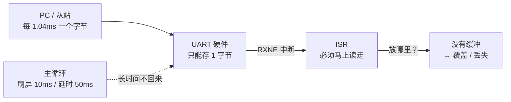
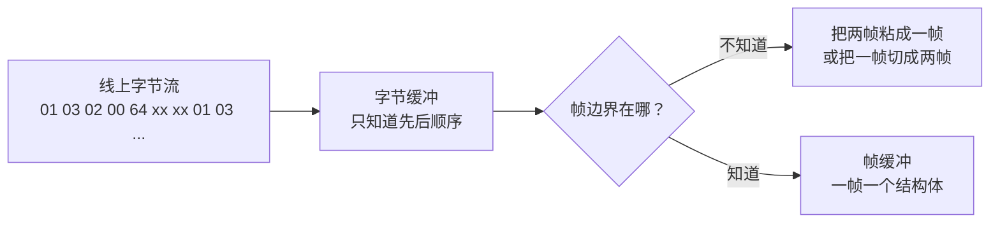
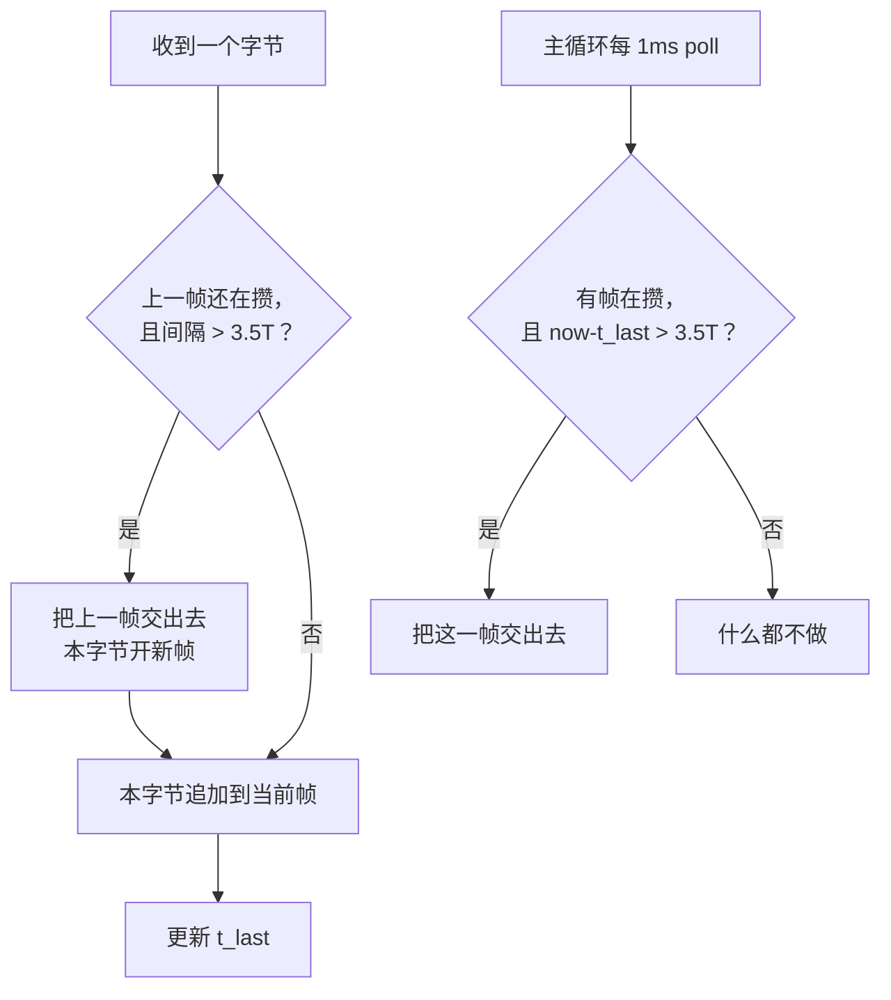

# 从环形缓冲到 Modbus 网关：一条接收通道的八级进化

> 读完这篇你会得到什么：
> 1. 能用"生产者快、消费者慢"解释串口为什么丢字节，以及环形缓冲到底削掉了什么峰；
> 2. 能把 256 字节的字节缓冲，一步步改成能认出"一帧从哪开始、到哪结束"的接收通道；
> 3. 能照敲 DMA + IDLE + 3.5T 判帧 + CRC + 解析的骨架，并用串口助手测出对错；
> 4. 知道主站和从站各写哪一侧、网关为什么要轮询；
> 5. 知道你现在站在能力地图的哪一格、下一步只做哪两件事。

> 说明：本文的代码是"能照敲的骨架"，不是完整工程。我没有在你的工程里编译或上板验证过，句柄名（`huart1/huart2`）、引脚名请按你的实际工程替换。

## 这篇的起点：你写过的两段代码

先把"基底"落在真实文件上，后面每一节都从这里往外长。

| 用途 | 真实路径 | 关键函数 / 变量 |
|---|---|---|
| 环形缓冲本体 | `02_知识库/04_编程语言/环形缓冲区.md` 第 4 节 | `rb_put()`、`rb_get()`、`rb_empty()`、`rb_full()`；`rb_buf[RB_SIZE]`、`rb_head`、`rb_tail`，`RB_SIZE = 256` |
| 串口收字节 | `08_归档/UART空闲中断实验/IT方式/Src/main.c` | `HAL_UARTEx_ReceiveToIdle_IT()`、`HAL_UARTEx_RxEventCallback()`、`rxData[LENGTH]`、`LENGTH = 64` |
| 串口收字节（DMA 版） | `08_归档/UART空闲中断实验/DMA方式/Src/main.c` | `HAL_UARTEx_ReceiveToIdle_DMA()`、同一个回调 `HAL_UARTEx_RxEventCallback()` |
| 目标工程 | `H:\Projects\modbus-edge-gateway` | 目前只有 `firmware/Core` 下的 HAL 骨架，还没有协议栈模块 |

两点如实说明：

1. 我在你的工程目录里**没有找到独立的 `ringbuf.c` / `ringbuf.h`**。能编译、最完整的一份环形缓冲实现，就在上面那篇笔记的第 4 节里（文件里也写着"后续可补上本人工程里的实现代码"）。所以这篇以它为准。
2. `H:\Projects\STM32\STM32\ESP8266\DMA-ESP8266访问服务器-AI\Project\Core\Inc\ESP8266.h` 里虽然声明了 `rxWriteIdx` / `rxReadIdx` 并注释成"接收环形缓冲区"，但实现里只在清空时把它们置 0，读数据是整段 `memcpy`，并没有真的绕圈。它不是一份可用的环形缓冲，不能当基底，这里只作为"命名很像、实现没跟上"的提醒。

---

## 0. 先把问题说清楚：为什么会丢字节

**目标**：能用自己的话讲出"每来一个字节进一次中断，主循环忙不过来就丢"，并知道缓冲解决的是哪一段。

先把几个词说清楚：

- **UART**：单片机上那种"一根线收、一根线发"的串口。它按**波特率**（每秒传多少个 bit，9600 就是每秒 9600 个 bit）一位一位地收。
- **字节**：8 个 bit 组成一个数据单位。除了 8 个数据位，一帧字符还要有**起始位**（告诉对方"我要开始了"）、**停止位**（告诉对方"这个字符完了"）。8 数据位 + 1 起始 + 1 停止 = 10 bit；如果再加 1 位校验位就是 11 bit。
- **中断（Interrupt）**：硬件遇到事件时打断 CPU 正在做的事，跳去执行一段专门的函数，这段函数叫 **ISR（中断服务函数）**，执行完再回来。串口每收到一个字节，硬件就会置位一个标志（`RXNE`，"接收寄存器非空"），如果你开了接收中断，CPU 就会进一次 ISR。
- **主循环**：`while (1)` 里你自己写的那一大段业务代码。它和中断是"抢占"关系：中断随时能打断主循环，主循环不能打断中断。

**旧代码哪里不够**

你现在的收字节代码（`08_归档/UART空闲中断实验`）是"收一段、回显一段"：

```c
uint8_t rxData[64];
HAL_UARTEx_ReceiveToIdle_IT(&huart1, rxData, 64);   /* 启动接收 */

void HAL_UARTEx_RxEventCallback(UART_HandleTypeDef *huart, uint16_t Size)
{
    if (huart->Instance == USART1) {
        printf("数据已接收,数据如下:\r\n");          /* 阻塞发送，在中断里！ */
        HAL_UART_Transmit_IT(&huart1, rxData, Size);
        HAL_UARTEx_ReceiveToIdle_IT(&huart1, rxData, 64); /* 重新启动 */
    }
}
```

它在"一个人对着串口助手发一条、看一条"的实验中是对的，但放到网关里会出三个问题：

1. **数据没有地方暂存**。回调一来就必须马上把它发回去；如果主循环正在做别的事（刷 OLED、算 CRC、等 Flash 写入），这段数据只能干等。
2. **64 字节固定缓冲**。超过 64 字节的帧会被硬件截断成多段，你在应用层得自己拼，代码里却没有拼的逻辑。
3. **中断里干重活**。`printf` 是阻塞发送，在 ISR 里调用会把中断拖很久，期间新来的字节就可能丢。

**为什么会丢：算一笔账**

本项目 USART2 是 **9600 8N1**：8 个数据位 + 1 个起始位 + 1 个停止位 + 0 个校验位 = **10 bit**。

```
1 个字符时间 = 10 / 9600 ≈ 1.042 ms
```

也就是**每 1.042 ms 就可能来一个字节**。如果你的主循环里有 `HAL_Delay(50)`，或者刷一次 OLED 要 10 ms，那么这 50 ms 里线上可能来了约 48 个字节。硬件接收寄存器只能放 1 个字节；CPU 没及时读走，第二个字节一到，`ORE`（Overrun，溢出）标志置位，**新字节直接被硬件丢掉**，而且你往往不知道。

> 对照：如果把 USART2 改成 8E1（多 1 位校验位，共 11 bit），1 字符 = 11/9600 ≈ 1.146 ms。本文所有数值一律按本项目的 8N1 口径算。



一句话总结：**生产者的速度由波特率决定，消费者的速度由你的主循环决定；两者不匹配时，中间必须有个"水池"，这个水池就是缓冲区。**

**改动点**：先不改中断方式，只在"ISR 收到字节"和"主循环处理"之间加一个能暂存的容器。下一节就用你写过的环形缓冲。

**代码骨架（先看"坏"与"好"的对比）**

```c
/* 坏：在主循环里阻塞等一个字节，忙起来就丢 */
while (1) {
    uint8_t b;
    HAL_UART_Receive(&huart1, &b, 1, 10);  /* 最多等 10ms，其他事全停 */
    do_something(b);
}

/* 好：ISR 只管"塞进水池"，主循环慢慢"从水池取" */
void HAL_UART_RxCpltCallback(UART_HandleTypeDef *huart) {
    if (huart->Instance == USART1) {
        rb_put(&g_rb, g_last_byte);        /* 只做一次很短的写入 */
        HAL_UART_Receive_IT(huart, &g_last_byte, 1); /* 立刻准备下一个 */
    }
}
```

**验收现象**（都能用串口助手测，不需要示波器）

- 让 PC 连续发 100 个字节（9600 8N1 下约 104 ms），主循环里加 `HAL_Delay(50)`：老写法会少字节，新写法（有缓冲）一个不少。
- 在主循环里打印"已收字节数"，数字应该持续增长，且和 PC 端发送总数对得上。

**常见错误**

| 现象 | 原因 |
|---|---|
| 加了缓冲还是丢 | 中断优先级太低，被别的中断压住；或 ISR 里调用了 `printf`/`HAL_Delay` |
| 收到的字节顺序乱 | 多个地方同时写同一个缓冲（多生产者），没有临界区 |
| 第一次能收，之后不动 | 回调最后忘了重新调用接收启动函数 |

---

## 1. 最朴素的环形缓冲：逐行讲你原来的写法

**目标**：把 `rb_put` / `rb_get` 讲到能徒手默写，并说清 `volatile`、判空判满、临界区、溢出策略。

先把"环形"这个词拆开。普通数组 `buf[0..255]` 写满 256 个就到头了；环形缓冲的做法是**写到最后一个格子后回到 0 继续写**，像跑道一样绕圈，所以叫环形（Ring Buffer），也叫 FIFO（First In First Out，先进先出）。

**旧代码哪里不够**

你笔记里的版本是能用的最小版，但只回答了"怎么绕圈"，没回答工程里的四个问题：

```c
#define RB_SIZE 256
static uint8_t  rb_buf[RB_SIZE];
static volatile uint32_t rb_head, rb_tail;

static inline bool rb_empty(void){ return rb_head == rb_tail; }
static inline bool rb_full(void){ return ((rb_head + 1) & (RB_SIZE - 1)) == rb_tail; }

bool rb_put(uint8_t d){
    if (rb_full()) return false;              /* 满则丢掉 */
    rb_buf[rb_head] = d;
    rb_head = (rb_head + 1) & (RB_SIZE - 1);
    return true;
}
bool rb_get(uint8_t *d){
    if (rb_empty()) return false;
    *d = rb_buf[rb_tail];
    rb_tail = (rb_tail + 1) & (RB_SIZE - 1);
    return true;
}
```

1. 只有一对全局变量，工程里会有多个串口、多个缓冲，不能共用一份；
2. 满了只是 `return false`，**丢了多少不知道**，项目验收要"丢帧率"，必须有计数；
3. 没讲清楚什么时候需要临界区；
4. 没定义"丢新还是丢旧"。

**逐行讲**

| 代码 | 含义 | 新手最容易错的地方 |
|---|---|---|
| `static uint8_t rb_buf[256]` | 固定大小的数组，就是"水池" | 以为越大越好；20KB RAM 的 F103 上，每个串口开 1KB 就要算账 |
| `volatile uint32_t rb_head` | 告诉编译器：这个变量会被中断改，每次都必须真的去内存读，不许缓存到寄存器 | 忘了 `volatile`，主循环可能一直读到一个旧值，看起来"永远收不到" |
| `head`（写指针） | 下一个要写的位置 | 把它叫成"尾"；名字不重要，**谁改它**才重要 |
| `tail`（读指针） | 下一个要读的位置 | 同上 |
| `rb_head == rb_tail` | 空 | 如果同时用它表示满，就分不清空和满了 |
| `((head + 1) & (N - 1)) == tail` | 满：再写一格就会追上读指针 | 牺牲了一个格子，所以 256 的数组实际只能存 255 个字节 |
| `& (RB_SIZE - 1)` | 代替 `% RB_SIZE` 的取模，快 | **只有 RB_SIZE 是 2 的幂时才对**；写成 100 就全乱 |
| `rb_buf[head] = d; head = ...` | 先写数据，再挪指针 | 顺序反了：指针先动，中断插进来会读到还没写的数据 |

**为什么"牺牲一个空位"**：`head == tail` 天然表示空。如果再规定 `head == tail` 也表示满，这个条件就有两种含义，程序没法判断。所以留一个永远不用的格子：当"再写一格就碰到 tail"时，就认为满了。这也是为什么 256 字节的数组只能存 255 字节。

**`volatile` 到底保证什么、不保证什么**

- 保证：编译器不会把 `rb_head` 缓存到寄存器，每次都去内存读，你能看到中断改后的新值。
- **不保证原子性**。"原子"意思是"这一步要么全做完，要么一点没做，中间不会被打断"。`rb_buf[head] = d` 加 `head++` 是两步，如果在两步之间进中断并且中断也写这个缓冲，就会坏。
- 所以：**单生产者 + 单消费者**（只有一个中断写、只有一个主循环读）可以不加锁；一旦有第二个写者（比如两个串口中断写同一个缓冲，或者主循环也往里写），就必须加**临界区**。

**临界区**：把一段代码"保护起来"，执行期间不允许中断插进来。裸机常用：

```c
__disable_irq();        /* 关全局中断 */
/* 这里放不能被中断打断的几步 */
__enable_irq();         /* 开全局中断 */
```

注意：关中断会让串口暂时收不到字节，所以临界区必须**只有几条指令**，不能在里面 `printf`、不能延时。FreeRTOS 里更规范的是 `taskENTER_CRITICAL()` / `taskEXIT_CRITICAL()`，第 7 节再说。

**溢出时丢新还是丢旧**

| 策略 | 做法 | 适合场景 | 用在 Modbus 接收上的后果 |
|---|---|---|---|
| 丢新（本文选择） | 满了就拒绝新字节，`overrun++` | 旧数据仍然完整、有价值 | 丢的是一整帧的尾部，下一帧还能完整重来 |
| 丢旧（覆盖最老） | 满了就覆盖 `tail` 指向的旧字节 | 只要最新值，比如传感器最新读数 | 会把一帧的**前半段**挤掉，剩下半帧被当成新帧，解析必错 |

Modbus 是"一帧一帧"的协议，半帧比没帧更危险，所以**接收缓冲用丢新 + 计数**。这也是你项目档卡里"overrun 策略"要回答的问题。

**改动点**：把全局变量收进一个结构体（一个串口一个实例）、加 `overrun` 计数、把"满则丢"写清楚。

**代码骨架**

```c
/* ringbuf.h */
#ifndef RINGBUF_H
#define RINGBUF_H

#include <stdint.h>
#include <stdbool.h>

#define RB_SIZE 256u                 /* 必须是 2 的幂 */

typedef struct {
    uint8_t  buf[RB_SIZE];
    volatile uint32_t head;          /* 写指针：只有生产者改 */
    volatile uint32_t tail;          /* 读指针：只有消费者改 */
    volatile uint32_t overrun;       /* 因满而丢掉的字节数 */
} RingBuf;

void     rb_init(RingBuf *rb);
bool     rb_put(RingBuf *rb, uint8_t data);
bool     rb_get(RingBuf *rb, uint8_t *data);
uint32_t rb_used(const RingBuf *rb);

#endif
```

```c
/* ringbuf.c */
#include "ringbuf.h"

static inline uint32_t rb_next(uint32_t i) { return (i + 1u) & (RB_SIZE - 1u); }

void rb_init(RingBuf *rb) { rb->head = 0; rb->tail = 0; rb->overrun = 0; }

bool rb_put(RingBuf *rb, uint8_t data)
{
    uint32_t next = rb_next(rb->head);
    if (next == rb->tail) {          /* 满：丢新，并记账 */
        rb->overrun++;
        return false;
    }
    rb->buf[rb->head] = data;        /* 先写数据 */
    rb->head = next;                 /* 再挪指针 */
    return true;
}

bool rb_get(RingBuf *rb, uint8_t *data)
{
    if (rb->head == rb->tail) return false;   /* 空 */
    *data = rb->buf[rb->tail];
    rb->tail = rb_next(rb->tail);
    return true;
}

uint32_t rb_used(const RingBuf *rb)
{
    return (rb->head - rb->tail) & (RB_SIZE - 1u);  /* 无符号减法自动绕回 */
}
```

**验收现象**

1. PC 连续发 300 个字节，你的程序读走 256 个以内后 `rb_used()` 应回到 0，`overrun` 应等于"没读走的数量"，且收到的字节顺序和 PC 发的完全一致。
2. 只写不读，写 300 次后 `rb_put` 从第 256 次开始返回 `false`，`overrun` 持续增加。
3. 写满一轮再读空一轮，反复 100 次，`rb_used()` 始终在 0..255 之间，不会变成奇怪的大数。

**常见错误**

| 现象 | 原因 |
|---|---|
| 永远读到 0 个字节 | `head/tail` 没加 `volatile`，主循环读到寄存器里的旧值 |
| 数据错位、偶尔跳字节 | `RB_SIZE` 不是 2 的幂却用了 `& (N-1)` |
| 满判断早了一格或晚了一格 | 忘了"牺牲一个空位"，把 `head == tail` 同时当空和满 |
| 偶发死机 | 在中断和主循环里都调用 `rb_put`，没有临界区 |
| 计数对不上 | `overrun` 也在中断里加，但主循环读它时没考虑它是 32 位（M3 上 32 位对齐读写是原子的，8 位机上不是） |

---

## 2. 用它"收完一帧再处理"：卡在哪

**目标**：明白"有字节缓冲"不等于"有帧缓冲"，找到从字节到帧的那道坎。

先把两个词分清：

- **字节缓冲**：一格存 1 个字节，只关心"别丢"，不关心这些字节属于哪一帧。
- **帧（Frame）**：一次完整通信的最小单位。Modbus RTU 的一帧 = 从站地址 + 功能码 + 数据 + CRC 校验，长度不固定。**帧缓冲**要能回答"这一帧从第几个字节开始、到第几个字节结束"。



**旧代码哪里不够**

你的环形缓冲只解决"字节按顺序存下来"，它没有任何"边界"信息。拿它直接接协议解析，会遇到三个具体问题：

1. **不知道一帧有多长**。Modbus 帧长度是变的（03 响应可能是 7 字节，读 10 个寄存器可能是 25 字节），不能靠固定长度切。
2. **不知道什么时候"这一帧发完了"**。字节是一个一个来的，中间可能隔 1 ms，也可能隔 10 ms；你不能每来一个字节就解析一次。
3. **处理慢会拖垮缓冲**。如果主循环每次只取 1 个字节、解析一次，解析器状态要跨调用保存，写起来很容易乱；如果一次全取走，又不知道取到哪一帧为止。

**改动点**：在字节缓冲和解析器之间，加一个"攒帧"的角色。它做的事只有两件：

- 按到达时间判断"上一帧结束了"；
- 把攒好的一整帧交给下一级（第 3、4 节实现）。

**代码骨架（先只定义"一帧"长什么样）**

```c
/* 一帧最多 256 字节：Modbus RTU 单帧上限 */
typedef struct {
    uint8_t  buf[256];
    uint16_t len;          /* 本帧实际字节数 */
    uint32_t ts_us;        /* 最后一个字节的到达时刻，单位微秒 */
} MbFrame;
```

**验收现象**

- 让 PC 发两帧、中间**不留间隔**（比如连续 `01 03 00 00 00 01 C5 CD` 两次），你的程序应该能报出"2 帧"，而不是 1 帧 16 字节。
- 让 PC 发一帧、中间故意停 6 ms，你的程序应该报"2 帧"（第二段虽然不完整，但它确实是一次新的传输）。

**常见错误**

| 现象 | 原因 |
|---|---|
| 两帧粘成一帧 | 把"一次回调的 Size"当成"一帧的长度" |
| 一帧被切成两帧 | 把缓冲区的"半满中断"当成帧结束，或者固定按 8 字节切 |
| 解析器偶尔读到上一帧的尾巴 | 帧缓冲是同一个数组，交给下一级后又被下一次接收覆盖（第 7 节用队列解决） |

---

## 3. 从字节缓冲升级到段缓冲：DMA + IDLE

**目标**：理解 DMA 为什么能减少中断、IDLE 给的是什么、Circular 和 Normal 的区别，以及为什么 DMA 缓冲要大于 258。

先解释三个词：

- **DMA（Direct Memory Access，直接内存访问）**：芯片里一个"搬运工"。你告诉它"从串口数据寄存器搬到内存某个数组"，它自己搬，CPU 可以去干别的。搬完或搬够一定数量，它才打断 CPU 一次。
- **IDLE（空闲）中断**：串口线上连续空闲超过 1 个字符时间，硬件置位 IDLE 标志并触发中断。它回答的是"这一小段发完了"。
- **NDTR（Number of Data to Transfer）**：DMA 里"还剩多少个没搬"的计数器。缓冲大小减去 NDTR，就是"已经搬到哪个位置"。

**为什么能减少中断**

| 方式 | 谁来搬字节 | 中断频率（9600、连续发 20 字节） |
|---|---|---|
| 纯接收中断（RXNE） | CPU 在 ISR 里读 1 个字节 | 20 次 |
| DMA + IDLE | DMA 搬，CPU 只在空闲时处理 | 1 次 |

中断次数少，不是"省电"这么简单：每次进 ISR 都有保存/恢复现场的开销，中断太密会把主循环切得很碎，也会让高优先级任务得不到连续时间。

**旧代码哪里不够**

你的 `08_归档/UART空闲中断实验/DMA方式` 已经是 DMA + IDLE，但它的用法是"收一段、回显一段、重装一次"，缓冲 64 字节：

```c
HAL_UARTEx_ReceiveToIdle_DMA(&huart1, rxData, 64);
```

它不适合协议接收的地方：

1. 64 字节小于 Modbus 最大帧（256 字节），长帧会被 DMA 收满截断；
2. 回调里立刻回显，等于把"接收"和"处理"绑死；
3. 没区分"这一段是一次完整传输，还是被截断的半截"。

**Circular 与 Normal：先用哪个**

| 维度 | Normal（普通模式） | Circular（循环模式） |
|---|---|---|
| DMA 收满缓冲后 | 停下来，等你重新启动 | 自动回到 0 继续写，永不停止 |
| `Size` 的含义 | 本次实际收到的字节数 | 本次事件相对上次的增量，需要自己用 NDTR 算 |
| 处理时会不会被覆盖 | 不会，DMA 已停 | 会，DMA 还在写 |
| 适合 | **先把"段"的概念跑通、单帧处理** | 连续高速流、零丢帧工程版 |
| 代价 | 每段都要手动重装 | 要自己维护读位置、检测绕圈覆盖 |

对你现在的阶段，**先用 Normal 判帧**，原因是它把"一段"变得很明确：DMA 停了，数据不会在你解析时被改；`Size` 就是这一段长度。等你把 3.5T 和解析跑通，再换 Circular 做零丢帧——你的项目清单里写的是 Circular，那是工程版的做法，不是入门第一步。

Circular 版的取段方法（换的时候再看）：

```c
/* Circular + IDLE：DMA 一直在写，用 NDTR 推算这次写到了哪 */
uint32_t pos = DMA_BUF_LEN - __HAL_DMA_GET_COUNTER(&hdma_usart2_rx);
uint16_t seg = (pos >= rx_last_pos) ? (uint16_t)(pos - rx_last_pos)
                                    : (uint16_t)(DMA_BUF_LEN - rx_last_pos + pos);
rx_last_pos = pos;
```

Circular 下必须自己防"覆盖"：如果主循环处理太慢，DMA 绕一圈回来会盖掉还没读的数据。Normal 下不会，因为它收满就停。

**为什么 DMA 缓冲要大于 258**

Modbus RTU 单帧最长 **256 字节**（地址 1 + 功能码 1 + 数据最多约 253 + CRC 2）。如果 DMA 缓冲正好 256：

- 收到一个"合法的满帧"时，DMA 也刚好收满停下；
- 收到一个"超长/异常帧"时，DMA 同样收满停下；
- 两种情况从现象上**分不出来**，你没法判断是"正常满帧"还是"溢出"。

所以缓冲要留余量，常用 **258 = 256 + 2**：正常帧最多写到 256，多出来的 2 个位置用来"接住"异常帧多出的字节，让你能看出"已经超过 256 了，这一帧不合法，丢掉并计数"。

**改动点**：把 64 改成 258；回调里只做"记长度 + 打时间戳 + 交给攒帧函数"，不做回显/解析；Normal 模式末尾必须重装。

**代码骨架**

```c
#define DMA_BUF_LEN 258u                 /* 256 帧上限 + 2 字节溢出检测余量 */
static uint8_t dma_buf[DMA_BUF_LEN];

void mb_uart_start(void)
{
    HAL_UARTEx_ReceiveToIdle_DMA(&huart2, dma_buf, DMA_BUF_LEN);  /* Normal 模式 */
}

/* IDLE 触发后由 HAL 调用；运行在中断上下文，必须短 */
void HAL_UARTEx_RxEventCallback(UART_HandleTypeDef *huart, uint16_t Size)
{
    if (huart->Instance != USART2) return;

    mb_rx_feed_batch(dma_buf, Size, mb_now_us());   /* 只攒帧，不解析、不 printf */

    HAL_UARTEx_ReceiveToIdle_DMA(&huart2, dma_buf, DMA_BUF_LEN); /* Normal 必须重装 */
}
```

**验收现象**

- 发 8 个字节：回调只进 1 次（在回调里对一个计数变量 `++`，主循环打印）。
- 发 300 个字节：`Size` 会停在 258 附近，你的程序应该报"超长帧/溢出"，而不是把 300 字节当一帧解析。
- 发一帧合法的 25 字节：`Size` 应等于 25，且没有触发"超长"分支。
- 拔掉 USB-TTL 再插上：接收能自动恢复（说明重装没漏）。

**常见错误**

| 现象 | 原因 |
|---|---|
| 只收到第一批，之后不动 | 用了 Normal 却忘了在回调末尾重装 |
| `Size` 总是 258 | 波特率/接线问题导致一直有噪声；或根本没发完，IDLE 没来，DMA 收满 |
| 长帧被切成两段 | 缓冲小于帧长，或波特率太高、主循环没来得及重装 |
| Circular 下数据偶尔跳变 | DMA 绕圈覆盖了未读数据，读位置没跟上 |
| 回调里卡死 | 在 ISR 里 `printf`、`HAL_Delay`、或做 CRC/解析 |

---

## 4. 3.5T 判帧：IDLE 只是"1 个字符空闲"

**目标**：讲清为什么有了 IDLE 还要时间戳二次判定，并写出"回调 + 主循环轮询"两条收尾路径。

先解释 **3.5T**：

- **T** 指 1 个字符的传输时间。本项目 USART2 是 **9600 8N1**，1 字符 = 10 bit，所以 `T = 10/9600 ≈ 1.042 ms`。
- **3.5T** 就是 3.5 个字符时间。本项目口径：`3.5 × 1.042 ms ≈ **3.65 ms**`（精确值 3646 µs）。Modbus RTU 规定：**帧内字节间隔不能超过 1.5T，帧与帧之间至少安静 3.5T**。换句话说，线上安静超过 3.65 ms，就认为上一帧结束了。

| 串口格式 | 1 字符 bit 数 | 1 字符时间（9600） | 3.5T |
|---|---|---|---|
| **8N1（本项目）** | **10 bit** | **1.042 ms** | **3.65 ms / 3646 µs** |
| 8E1（仅作对照） | 11 bit | 1.146 ms | 4.01 ms / 4010 µs |

> 4.01 ms 只在 8E1（或 8N2）这种 11 bit/字符的配置下成立。**本项目的阈值是 3646 µs，不是 4010 µs**；改校验位/停止位时要同步改下面的 `MB_BITS_PER_CHAR`。

**旧代码哪里不够**

IDLE 中断的触发条件是"空闲超过 **1 个字符**"，不是 3.5 个字符。这带来两个问题：

1. **太早判帧**。协议允许帧内字节之间有不超过 1.5T 的间隔。本项目 9600 8N1 下 1.5T ≈ 1.56 ms，而 IDLE 在 1.04 ms 就可能触发。如果从站发字节时中间抖了一下，IDLE 会把一帧判成两帧。
2. **最后一帧没人收尾**。IDLE 只在"从有数据变成没数据"时触发一次。假设你收到最后一个字节后，线上再也没来新字节，那么"这一帧结束"这件事，只能靠**时间**去判，不能靠"下一个字节来了"去判。

**为什么要时间戳二次判定**

不要相信"IDLE 来了就是帧尾"，而是自己记账：

- 每收到一个字节，记下它的到达时刻 `t_last`（微秒）。
- 收到下一个字节时，如果 `now - t_last > 3.5T`，说明中间安静太久了：**上一帧在这里结束，当前这个字节属于新帧**。
- 如果一直没有下一个字节，就由主循环/定时器每隔 1 ms 检查一次：`now - t_last > 3.5T` 就收尾。

这就是"两条收尾路径"：



**为什么两条都要**：回调路径负责"新字节来了，顺便发现上一帧该结束"；poll 路径负责"新字节不来了，最后一帧也得结束"。少一条，就会漏帧或粘帧。

**改动点**：把"攒帧"写成一个带状态的小模块，输入是 `(字节, 当前微秒)`，输出是"一帧完成"的回调。时间源优先用 `DWT->CYCCNT`（CPU 周期计数器，72 MHz 下约 13.9 ns 一格，不用占外设），或者你项目里的 TIM2（预分频到 1 µs）。**别用 TIM4**，它通常是 HAL 的时基。

**代码骨架**

```c
/* 本项目 USART2：9600 8N1 → 1 字符 10 bit → 3.5T = 3646 µs
 * 若改 8E1（11 bit）→ 4010 µs。改配置只改下面两个宏，别改结果。 */
#define MB_UART_BAUD       9600u
#define MB_BITS_PER_CHAR   10u    /* 8N1 = 10；8E1 / 8N2 = 11 */
/* 3.5 * bits / baud，单位 µs；加 baud 是为了四舍五入到整数 */
#define MB_T35_US (((7u * MB_BITS_PER_CHAR * 1000000u) + MB_UART_BAUD) / (2u * MB_UART_BAUD))

typedef enum { MB_RX_IDLE = 0, MB_RX_ACTIVE } mb_rx_state_t;

static struct {
    mb_rx_state_t state;
    uint32_t t_last_us;
    uint8_t  buf[256];
    uint16_t len;
    uint32_t overrun;            /* 超长帧计数 */
} rx;

static void mb_frame_done(const uint8_t *buf, uint16_t len, uint32_t ts_us); /* 下一级实现 */

/* 每来一个字节调用一次（可在 DMA 回调里按 Size 循环调用） */
void mb_rx_feed(uint8_t b, uint32_t now_us)
{
    /* 路径一：新字节来了，发现上一帧已经安静太久 → 先收尾 */
    if (rx.state == MB_RX_ACTIVE && (uint32_t)(now_us - rx.t_last_us) > MB_T35_US) {
        mb_frame_done(rx.buf, rx.len, rx.t_last_us);
        rx.len = 0;
        rx.state = MB_RX_IDLE;
    }

    if (rx.state == MB_RX_IDLE) {          /* 本字节开启新帧 */
        rx.state = MB_RX_ACTIVE;
        rx.len = 0;
    }

    if (rx.len < sizeof(rx.buf)) {
        rx.buf[rx.len++] = b;
    } else {                                /* 超过 256：非法，整帧丢弃 */
        rx.overrun++;
        rx.len = 0;
        rx.state = MB_RX_IDLE;
    }
    rx.t_last_us = now_us;
}

/* 路径二：主循环或 1ms 定时器调用，负责"最后一帧"收尾 */
void mb_rx_poll(uint32_t now_us)
{
    if (rx.state == MB_RX_ACTIVE && (uint32_t)(now_us - rx.t_last_us) > MB_T35_US) {
        mb_frame_done(rx.buf, rx.len, rx.t_last_us);
        rx.len = 0;
        rx.state = MB_RX_IDLE;
    }
}

void mb_rx_feed_batch(const uint8_t *p, uint16_t n, uint32_t now_us)
{
    for (uint16_t i = 0; i < n; i++) mb_rx_feed(p[i], now_us);
}
```

这里 `(uint32_t)(now_us - rx.t_last_us)` 用的是无符号减法：即使时间戳从最大值绕回 0，差值仍然是对的。这是嵌入式时间比较的标准写法，别写成 `if (now_us > t_last + 3500)`，那会在绕回时出错。

**验收现象**

- 喂 8 个字节、字节间隔 1 ms → 输出 **1 帧**。
- 第 4、5 字节之间插 6 ms 空隙 → 输出 **2 帧**。
- 边界测试：以本项目阈值 3646 µs 为准，间隔 **3.6 ms 判 1 帧**，**3.7 ms 判 2 帧**。
- 发完最后一个字节后不再发，等 5 ms → poll 路径必须把这一帧交出来（不能等下一个字节）。
- 帧完成事件里带着"字节数 + 时间戳"，打印出来能对上 PC 端发送时间。

**常见错误**

| 现象 | 原因 |
|---|---|
| 两帧粘成一帧 | 只在回调里判，没有 poll 路径；或阈值取太大 |
| 一帧切成两帧 | 把 3.5T 算成"3.5 个字节"而不是"3.5 个字符时间"；或忘了 8N1 是 10 bit、8E1 才是 11 bit |
| 最后一帧永远不结束 | 只写了 feed，没写 poll |
| 换波特率就崩 | `MB_T35_US` 写死，或 `MB_BITS_PER_CHAR` 填错（8N1 填成 11 就会多算 0.36 ms） |
| 定时器一开就进中断 | 拿 TIM4 当 3.5T 计时，而它是 HAL 时基；改用 TIM2 或 DWT |
| 偶尔判帧错乱 | 时间戳在中断里读、在主循环里读，来源不一致；统一用同一个函数取时间 |

---

## 5. CRC 与解析：先看有没有抄错，再看想干什么

**目标**：分清"校验"和"解析"两件事，写出 CRC16 和响应帧解析的骨架。

先解释：

- **CRC（Cyclic Redundancy Check，循环冗余校验）**：发送方按约定算法对整帧算出一个 16 位"指纹"附在帧尾；接收方用同一算法再算一遍，对不上就说明传输中抄错了。它**不是加密**，只查错，不防篡改。
- **解析**：把一帧字节翻译成"谁问的、要干什么、数据是什么"。CRC 通过只说明"这帧没抄错"，不代表"这帧合法、是给我的"。

Modbus CRC16 的三个硬参数（你 2026-11-01 已经用三组向量验证过）：

1. 多项式 `0xA001`（它是 `0x8005` 的逐位反转，不是字节交换）；
2. 初值 `0xFFFF`（不是 `0x0000`）；
3. 发送顺序：**低字节先、高字节后**。

**旧代码哪里不够**

你现在的知识停在"CRC 能算对"，还没有"帧结构会随功能码变"的认识。最容易错的三点：

1. **请求帧没有 `byte_count`，响应帧才有**。比如 03（读保持寄存器）请求是 `地址 功能 起始地址高 起始地址低 数量高 数量低 CRC`，一共 8 字节，第 3 字节不是"字节数"；而 03 响应是 `地址 功能 字节数N 数据... CRC`，第 3 字节才是 N。**功能码决定了第 3 字节是"地址"还是"长度"**，这就是"字段布局开关"。
2. **异常帧没有数据区**。响应的功能码最高位为 1（`func & 0x80`）时，第 3 字节是**异常码**（01 非法功能、02 非法数据地址、03 非法数据值、04 从站故障），不是字节数。
3. **CRC 不需要"拆出来"**。整帧（含 CRC 两字节）丢进同一个 CRC 函数，结果应为 `0x0000`。这比"先算前 n-2 字节、再和最后两字节比"更省事，也不容易搞错字节序。

**改动点**：先写 CRC（已会，直接搬），再写"按功能码分叉"的解析器，输出一个结构体而不是一堆全局变量。

**代码骨架：CRC**

```c
uint16_t mb_crc16(const uint8_t *buf, uint16_t len)
{
    uint16_t crc = 0xFFFF;                 /* 初值 */
    for (uint16_t i = 0; i < len; i++) {
        crc ^= buf[i];
        for (uint8_t bit = 0; bit < 8; bit++) {
            if (crc & 1u) crc = (uint16_t)((crc >> 1) ^ 0xA001u);
            else          crc >>= 1;
        }
    }
    return crc;
}
```

**代码骨架：响应解析**

```c
typedef enum {
    MB_OK = 0,
    MB_ERR_CRC,        /* 校验不过：这帧抄错了 */
    MB_ERR_ADDR,       /* 不是给我的：静默丢弃，不算故障 */
    MB_ERR_EXC,        /* 从站回了异常码 */
    MB_ERR_LEN,        /* 长度和字节数字段对不上 */
    MB_ERR_TRUNC       /* 太短，连基本字段都不够 */
} MbStatus;

typedef struct {
    uint8_t  addr;
    uint8_t  func;
    uint8_t  byte_count;      /* 仅 03/04 响应有效 */
    uint8_t  data[253];       /* Modbus 数据区上限约 253 字节 */
    uint16_t data_len;
    uint8_t  exc_code;        /* 异常码，仅 MB_ERR_EXC 有效 */
    MbStatus status;
} MbFrame;

MbStatus mb_parse_response(const uint8_t *buf, uint16_t len,
                           uint8_t my_addr, MbFrame *out)
{
    if (len < 4) return MB_ERR_TRUNC;
    if (mb_crc16(buf, len) != 0) return MB_ERR_CRC;   /* 回灌校验：含 CRC 应得 0 */

    out->addr = buf[0];
    out->func = buf[1];

    if (out->addr != my_addr) return MB_ERR_ADDR;     /* 不是给我的，静默丢 */

    if (out->func & 0x80) {                            /* 最高位=1：异常帧 */
        out->exc_code = buf[2];
        return MB_ERR_EXC;
    }

    switch (out->func) {
    case 0x03:
    case 0x04:
        out->byte_count = buf[2];                      /* 第 3 字节才是字节数 */
        if ((uint32_t)len != 3u + out->byte_count + 2u) return MB_ERR_LEN;
        out->data_len = out->byte_count;
        for (uint16_t i = 0; i < out->byte_count; i++) out->data[i] = buf[3 + i];
        return MB_OK;

    case 0x06:                                          /* 写单个寄存器：回显 8 字节 */
    case 0x10:                                          /* 写多个寄存器：回显 8 字节 */
        if (len != 8) return MB_ERR_LEN;
        out->data_len = 4;                              /* 地址2 + 值/数量2 */
        for (uint16_t i = 0; i < 4; i++) out->data[i] = buf[2 + i];
        return MB_OK;

    default:
        return MB_ERR_LEN;                              /* 本阶段只支持 03/04/06/10 */
    }
}
```

**验收现象**

- CRC 三组向量：`01 03 00 00 00 0A` → `C5 CD`；`01 03 00 00 00 02` → `C4 0B`；`02 07` → `41 12`。任一字节改掉，CRC 必须变；整帧回灌必须得 `0x0000`。
- 解析六组向量（你清单里那六组）：
  1. 正常 `01 03 04 02 4C 00 BA xx xx` → `MB_OK`，`byte_count=4`；
  2. 改末字节 → `MB_ERR_CRC`；
  3. 地址 `02 ...` → `MB_ERR_ADDR`，且**不计入故障**；
  4. `01 83 02 xx xx` → `MB_ERR_EXC`，`exc_code=2`；
  5. 少发最后一个字节 → `MB_ERR_CRC` 或 `MB_ERR_TRUNC`（取决于断在哪，日志要打出来）；
  6. 长度字段写 `0xFF` → `MB_ERR_LEN`，且**不能越界读写**。
- 每条失败日志都能打出"在第几个字节、因为什么失败"。

**常见错误**

| 现象 | 原因 |
|---|---|
| 偶发 CRC 错 | 把 CRC 两个字节也算进了 `byte_count` 对应的长度校验 |
| 03 响应整体错位 | 漏了第 3 字节的字节数 N，把 N 当成了第一个数据 |
| 数组越界/死机 | `byte_count` 没做上限检查（最大约 253），直接 `memcpy` |
| 异常帧被当正常帧 | 没判 `func & 0x80` |
| 设备不认你发的帧 | CRC 高字节先发了；Modbus 要求低字节先 |
| 地址不匹配也报故障 | 地址不匹配是"总线上的别人的帧"，应静默丢，不算通信故障 |

---

## 6. 从站应答 / 主站轮询：角色一变，写的是不同的一侧

**目标**：分清主站和从站各写什么，理解网关为什么要轮询多个从站。

先解释：

- **主站（Master）**：主动发问的一方。你的网关就是主站。
- **从站（Slave）**：被动回答的一方。温湿度表、电表、你自制的 STM32 从机都是从站。
- **RS485**：一种"两根线、多个设备挂在同一对线上"的通信方式。它是**半双工**的：同一时刻只能有一个设备在说话，其他设备只能听。
- **轮询**：主站按顺序一个一个点名："1 号，报数据"；等它答完或超时，再问"2 号"。

**旧代码哪里不够**

你现有的代码都是"单机对串口助手"：收一段、回显一段。它没有"角色"概念：

- 从站需要"收到请求 → 校验 → 判断是不是问我 → 执行 → 组响应 → 发回去"；
- 主站需要"组请求 → 发出去 → 等响应（带超时）→ 解析 → 存起来"。

两者的**组包**和**解包**方向正好相反，不能拿同一段代码硬套。

**角色对照表**

| 环节 | 从站要写 | 主站要写 |
|---|---|---|
| 组包 | 组**响应**帧（数据 + 字节数 + CRC） | 组**请求**帧（起始地址 + 数量 + CRC） |
| 解包 | 解析**请求**帧（没有 byte_count） | 解析**响应**帧（03/04 有 byte_count） |
| 触发 | 被动：收到才动 | 主动：定时轮询 |
| 超时 | 一般不需要（应答即可） | 必须：等不到就换下一个 |
| 地址 | 只处理发给自己的 | 逐个点名 |

**网关为什么要轮询多个从站**

1. RS485 半双工，同一时刻只能一个人说话，不能所有从站同时上报；
2. 工业从站通常**不会主动上报**，只能被问才答；
3. 主站轮询可以控制节奏：每个从站给固定时间片，一个掉线不拖垮整条总线（这就是你项目里的"故障隔离"和"超时预算"）。

**改动点**：先写"主站组请求"，因为你的网关是主站；从站应答可以等自制的 2 号/3 号从机时再写，或者先用 PC 上的 Modbus Slave 软件模拟。

**代码骨架：主站组一个 03 请求**

```c
/* 读保持寄存器：slave 站号，start 起始地址，qty 寄存器个数（1..125） */
bool mb_build_read_holding(uint8_t slave, uint16_t start, uint16_t qty, uint8_t out[8])
{
    if (qty == 0 || qty > 125) return false;

    out[0] = slave;
    out[1] = 0x03;
    out[2] = (uint8_t)(start >> 8);
    out[3] = (uint8_t)start;
    out[4] = (uint8_t)(qty >> 8);
    out[5] = (uint8_t)qty;

    uint16_t crc = mb_crc16(out, 6);
    out[6] = (uint8_t)crc;           /* 低字节先 */
    out[7] = (uint8_t)(crc >> 8);
    return true;
}
```

**代码骨架：轮询一个从站的流程（伪代码，落在任务里）**

```c
for (每个从站 s) {
    uint8_t req[8];
    if (!mb_build_read_holding(s.addr, s.reg_start, s.reg_cnt, req)) continue;

    RS485_DE_HIGH();                              /* 切到发送 */
    HAL_UART_Transmit(&huart2, req, 8, 10);       /* 或 DMA 发送 */
    while (huart2.gState != HAL_UART_STATE_READY) {} /* 等最后一个 bit 发完 */
    RS485_DE_LOW();                               /* 切回接收 */

    if (mb_wait_frame(s.addr, 200)) {              /* 200ms 超时，等 3.5T 判出的一帧 */
        MbFrame f;
        if (mb_parse_response(frame_buf, frame_len, s.addr, &f) == MB_OK) {
            store_registers(s.addr, f.data, f.data_len);
            s.fail_count = 0;
        } else {
            s.fail_count++;
        }
    } else {
        s.fail_count++;                            /* 超时：记一次失败，继续下一个 */
    }

    if (s.fail_count >= 3) s.offline = true;       /* 连续失败 → 标记离线，跳过 */
}
```

**为什么 `DE` 要等发送完成再拉低**：`DE`（Driver Enable，RS485 收发器的发送使能）拉高时芯片在驱动总线，拉低后芯片回到"听"的状态。如果最后一个停止位还没发完就拉低，末字节会被截断，从站收到的是坏帧。

**验收现象**

- 用 PC 的 Modbus Poll（主站模拟）或 Modbus Slave（从站模拟）交叉验证：你发的请求能被软件正确应答，你也能解析它的响应。
- 挂 3 个从站（或软件模拟 3 个站号），轮询一圈的时间可以测出来（打印每个从站的开始/结束时间戳）。
- 拔掉 1 个从站：其余从站的数据仍然按周期刷新，掉线那个在 3 次失败后被标记离线，不阻塞总线。
- 恢复掉线从站：它能在下一轮或下几轮重新被点名并恢复。

**常见错误**

| 现象 | 原因 |
|---|---|
| 末字节偶尔丢失/从站不认 | `DE` 拉低太早，没等发送完成 |
| 从站回的数据被自己吞掉 | 半双工下发送和接收抢同一对线，`DE` 时序不对 |
| 一帧刚发完就发下一帧 | 帧间没留 3.5T，从站把两帧当一帧 |
| 一个从站掉线，全部卡住 | 没设超时，或超时太长且串行等待 |
| 读回的数据整体偏移 | 请求里起始地址/数量字节序写反（Modbus 是**高字节先**，和 CRC 相反） |

---

## 7. FreeRTOS：队列和环形缓冲不是替代关系

**目标**：把"中断只搬数据、解析放任务"落地，知道队列存什么、队列满了怎么办、栈怎么定。

先解释：

- **FreeRTOS**：一个实时操作系统（RTOS），它把 CPU 时间切成很多小片，分给不同**任务**（Task）。每个任务看起来像在"同时"跑。
- **队列（Queue）**：任务之间传数据的通道，可以存"若干个固定大小的东西"，先进先出。CMSIS-RTOS2 里叫 `osMessageQueue`。
- **栈（Stack）**：每个任务自己有的一块内存，放函数调用时的局部变量和返回地址。栈太小会溢出，表现为 HardFault 或随机死机。

**旧代码哪里不够**

你现在会用 `osMessageQueuePut/Get` 传按键计数（`UART_FreeRTOS/Core/Src/freertos.c` 里的 `myQueue01`），但还没把它和串口帧接起来。要注意：**队列不能替代环形缓冲**。

| 结构 | 存什么 | 解决什么 | 放在哪 |
|---|---|---|---|
| 环形缓冲 | **字节** | 生产者（串口）比消费者（主循环）快，先存住 | ISR 写，主循环/任务读 |
| 队列 | **一帧**（结构体） | 接收和解析解耦，解析慢也不影响收 | ISR 投递，解析任务取 |

两级配合：DMA/IDLE → 环形/段缓冲 → 3.5T 判出整帧 → **队列** → 解析任务。环形缓冲管"字节不丢"，队列管"整帧排队"。

**ISR 里只做三件事**：把字节喂给攒帧模块、判出整帧时投递队列、重新启动接收。**解析、CRC、打印、存 Flash 全部放任务里。**

**队列满怎么办**

| 策略 | 做法 | 适合 |
|---|---|---|
| 丢弃 + 计数（推荐） | `osMessageQueuePut` 超时 0，失败就 `drop++` | 协议帧：宁可丢一帧并记账，也不要阻塞中断 |
| 覆盖最旧 | `xQueueOverwrite`（仅长度 1 的队列） | 只要最新值，不适合协议帧 |
| 阻塞等待 | 在 ISR 里绝对不行 | — |

**队列长度怎么定**：按"最坏情况下同时有几帧没被处理"来定。3 个从站、每个最多 1 帧在途，再留余量，取 8 项足够。每项大小是 `sizeof(MbSegment)`（约 260 字节），8 项约 2KB，20KB RAM 的 F103 要算进预算；嫌大可以把 `buf` 改成"预分配池 + 队列只存索引"。

**栈怎么定**：解析任务的局部变量（一个 `MbFrame` 就有约 260 字节）加调用开销，512–1024 字节起步；用 `uxTaskGetStackHighWaterMark()` 看剩余最小值，留 30% 余量。CMSIS-OS2 的 `stack_size` 单位是**字节**，不是字。

**代码骨架**

```c
typedef struct {
    uint8_t  buf[256];
    uint16_t len;
    uint32_t ts_us;
} MbSegment;

osMessageQueueId_t mbSegQ;          /* 整帧队列 */

void mb_app_init(void)
{
    mbSegQ = osMessageQueueNew(8, sizeof(MbSegment), NULL);
    /* 再创建解析任务：栈 1024 字节，优先级低于串口中断、高于显示 */
}

/* 由 3.5T 模块在"一帧结束"时调用；可能在中断上下文 */
static void mb_frame_done(const uint8_t *buf, uint16_t len, uint32_t ts_us)
{
    MbSegment seg;
    if (len > sizeof(seg.buf)) return;
    for (uint16_t i = 0; i < len; i++) seg.buf[i] = buf[i];  /* 必须拷贝，源缓冲会被复用 */
    seg.len = len;
    seg.ts_us = ts_us;

    if (osMessageQueuePut(mbSegQ, &seg, 0, 0) != osOK) {
        /* 队列满：丢这一帧并计数，绝不在中断里等 */
        g_drop_count++;
    }
}

/* 解析任务 */
void ParseTask(void *arg)
{
    MbSegment seg;
    for (;;) {
        if (osMessageQueueGet(mbSegQ, &seg, NULL, osWaitForever) == osOK) {
            MbFrame f;
            MbStatus st = mb_parse_response(seg.buf, seg.len, MY_ADDR, &f);
            /* 只在这里做 CRC/解析/打印/入库 */
        }
    }
}
```

**验收现象**

- 高速灌入 1 分钟：`g_drop_count` 和 `rx.overrun` 都应该为 0（或你能解释每一个非 0 的来源）。
- 解析任务栈的高水位（`uxTaskGetStackHighWaterMark` 的返回值）应大于 100 字节，否则加栈。
- 把解析任务人为 `osDelay(50)`：接收端仍然不丢字节（因为字节在环形缓冲里），只是队列里会积压——这正好证明两级缓冲各自起作用。
- 拔掉串口线再插上：系统不重启、接收恢复。

**常见错误**

| 现象 | 原因 |
|---|---|
| 中断里调用 `osMessageQueuePut` 后死机/断言 | 用了阻塞超时；ISR 里应超时 0 |
| 解析出来的数据和预期差一帧 | 队列里存的是指针，指向会被下一次 DMA 覆盖的缓冲；必须拷贝 |
| 队列一直满 | 解析任务优先级太低或被 `osDelay` 拖住；或队列项太大导致内存不够 |
| 随机 HardFault | 任务栈太小（尤其解析任务里有 260 字节的结构体） |
| 以为加了队列就不会丢 | 队列满、环形缓冲满、DMA 覆盖是三处独立的丢点，要分别计数 |

---

## 能力地图：你现在在哪，下一步做什么


| 能力 | 你的状态 | 依据 |
|---|---|---|
| UART 收字节、回显 | **有** | `08_归档/UART空闲中断实验` 两版都能跑 |
| 环形缓冲判空/判满 | **有** | `环形缓冲区.md` 第 4 节 |
| DMA + IDLE 接收 | **有** | DMA 方式实验；但只做到"收一段回显一段" |
| CRC16 | **有** | 2026-11-01 三组向量 + 回灌归零通过 |
| 帧边界（3.5T） | **无** | 清单 ③ 未打勾 |
| 帧解析字段布局 | **半懂 / 未验证** | `进度_2026-11-02_帧解析字段认知修正.md`：func/byte_count 仍需固化 |
| 主站轮询、超时预算 | **无** | 尚未接真 RS485 |
| FreeRTOS 队列 | **会用，未接帧** | `UART_FreeRTOS` 传过按键计数 |
| 两级缓冲（环形 + 队列） | **无** | 尚未组合 |

**下一步只做两件事**

1. **把 3.5T 判帧跑通（不上板也能做）**：在 PC 上用串口助手或 Python 按"1 ms 间隔 / 6 ms 间隔"灌字节，只测 `mb_rx_feed` + `mb_rx_poll` 的输出是不是 1 帧 / 2 帧，以及 3.6 ms 与 3.7 ms 的边界（本项目 9600 8N1，阈值 3646 µs）。这一步过了，你才算真正跨过"字节 → 帧"的坎。
2. **把 `mb_parse_response` 的六组向量跑通**：CRC 已经会了，直接接上解析；每组失败都要能打出"第几字节、什么原因"。这一步过了，协议层字段级理解才算立住。

**现在不要跳的步骤**

- 不要跳过 3.5T 和解析，直接写 FreeRTOS 队列 / W25Q64 / MQTT。帧边界没做对，后面所有"零丢帧""断网补传"都是在错的地基上盖楼。
- 不要一上来就用 DMA Circular。先用 Normal 把"段"和"帧"跑通，再换 Circular 做工程版；否则你同时面对"绕圈覆盖"和"帧边界"两个变量，很难定位。
- 不要在没有 PC 端 Modbus Slave/Poll 交叉验证前，直接把真 RS485 从站接上总线。先用软件模拟，把请求/响应字节逐条对清楚。
- 不要在中断里做解析、打印、存 Flash。ISR 只搬数据，这是后面所有稳定性问题的分界线。

---

## 一页速查：从你的旧代码到网关

| 阶段 | 你原来有什么 | 加了什么 | 解决了什么 |
|---|---|---|---|
| 1 | `rb_put` / `rb_get` | 结构体化、overrun 计数 | 字节不丢、丢多少可知 |
| 2 | 64 字节 `rxData` | "一帧"结构体 | 知道字节属于哪一段 |
| 3 | `ReceiveToIdle_DMA` | 258 字节缓冲、回调只攒帧 | 长帧不截断、中断更少 |
| 4 | IDLE 回调 | 时间戳 + 3.5T + poll | 帧边界可判、不粘不切 |
| 5 | 会算 CRC | 按功能码分叉的解析器 | 知道这帧想干什么 |
| 6 | 单机回显 | 主站组包 + 轮询 + 超时 | 多个从站、故障隔离 |
| 7 | 队列传按键 | 队列传整帧、解析放任务 | 接收与解析解耦 |

## 配套阅读

[[教程_2026-11-03_Modbus零基础详解]]
