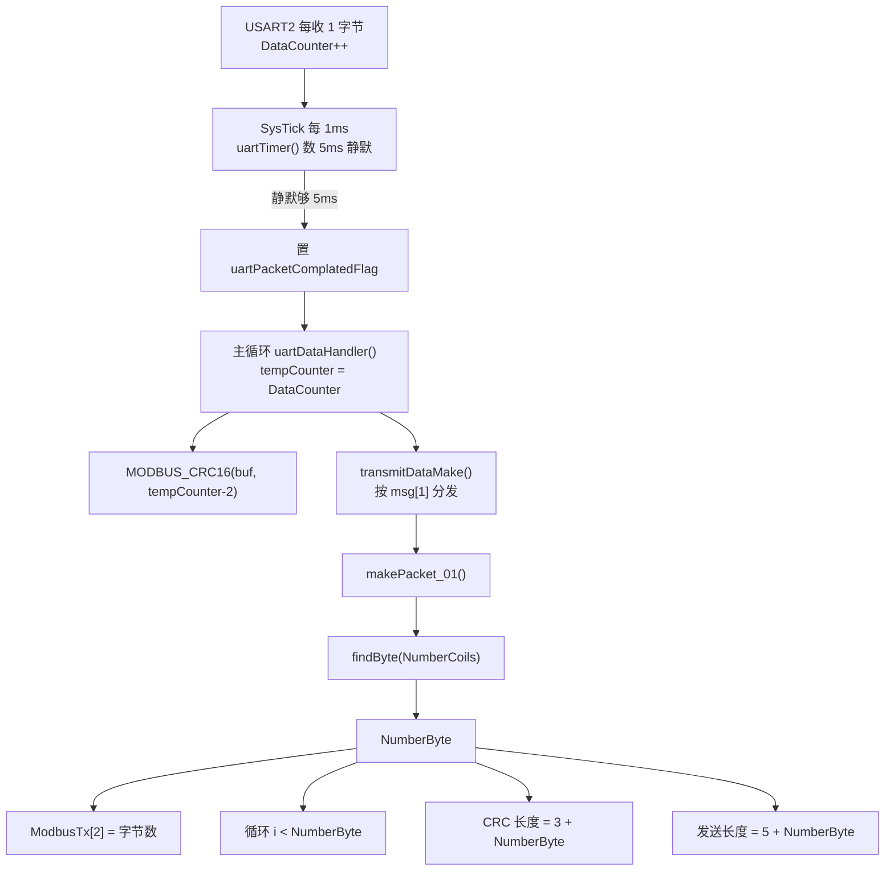

# 应答帧解析与计数函数：把 `findByte` 讲到能自己写

## 结论（先看这 6 句）

1. **这份工程是从站（Slave），不是主站**。它解析的是别人发来的**请求帧**，组的是自己发回去的**应答帧**；你说的"应答帧解析"，在这个工程里实际是"收到请求 → 检查 → 组应答"。
2. 你卡住的那个"计数工具函数"是 [`findByte()`](file:///H:/Projects/CubeIDE/ModBus_RS485_Damo/Core/APP/Modbus/modbus_rtu.c#L411-L418)（原版在备份 `.bak_20261104/modbus_rtu.c:299-315`）。
3. 它数的是**数据区需要几个字节**，不是寄存器个数，也不是帧内偏移：线圈按 **8 个一字节**打包，所以是 `ceil(线圈数 / 8)`。
4. **原版 `findByte` 本身有 bug**：用 `while (NumberOfCoil >= 0)` 减法计数，线圈数是 8 的整数倍时会多算 1（8 个线圈返回 2，应该是 1）。你看不懂不是你的问题——它确实不对，现版已改成 `(N + 7) / 8`。
5. `byte_count = 2N` **只对 16 位寄存器（0x03/0x04）成立**；线圈是 `ceil(N/8)`。读请求没有 `byte_count`，读应答才有；写多个则反过来——`byte_count` 在请求里。
6. 自己写解析的正确顺序是：**长度下限 → 地址 → 功能码/异常 → `byte_count` 与剩余长度核对 → CRC → 拷数据**。地址不匹配和 CRC 错都**静默丢弃**（不回任何字节），否则会和总线上的其他帧撞车。

> 说明：以下结论来自读代码（当前版 + `.bak_20261104` 原版对照），CRC 数值是用脚本算的，**没有上板验证**。本笔记不改动任何 `.c/.h`。

---

## 1. 先定位：这份工程里"数数"的东西有 6 个

先解释几个词，后面不再重复：

- **从站（Slave）**：被点名才回答的设备。地址 1、2、3……由拨码或宏定死。
- **主站（Master）**：主动点名的一方，比如你的网关。
- **功能码**：帧的第 2 个字节，表示"要干什么"（01 读线圈、03 读保持寄存器、06 写单个寄存器、10 写多个寄存器）。
- **线圈（Coil）**：只有 0/1 两种状态的开关量。为了省字节，Modbus 把 **8 个线圈塞进 1 个字节**，低位在前。
- **保持寄存器（Holding Register）**：一个 16 位的数值格子，可读可写，**1 个寄存器固定占 2 字节**。
- **byte_count**：数据区一共有多少**字节**，不是多少个寄存器/线圈。
- **CRC**：附在帧尾的 16 位"指纹"，用来发现传输抄错。

| 谁在数 | 位置 | 入参 → 返回 | 数的对象 | 谁用它 |
|---|---|---|---|---|
| **`findByte()`** | `Core/APP/Modbus/modbus_rtu.c:411-418`（原版 `.bak_20261104/modbus_rtu.c:299-315`） | `int16_t 线圈数` → `uint8_t` | **数据字节数** = `ceil(N/8)` | `makePacket_01()` 第 213 行 → `NumberByte` |
| `DataCounter` | `modbus_rtu.c:20`；中断里 `:58-61`，主循环 `:120-121` | 全局变量，无返回 | **已收到的字节数**（最多 255，下标 0..254） | `uartDataHandler()` 快照成 `tempCounter`；`tempCounter - 2` 给 CRC；`< 4` 丢弃 |
| `ByteCount` | `modbus_rtu.c:209`，`i=0..7` | 局部变量 | 当前正在写的**数据字节下标** | `tempCoil[ByteCount] |= ...`；等价于 `i >> 3` |
| `MODBUS_CRC16(buf,len)` 的 `len` | `modbus_rtu.c:421` | `char*`、`uint8_t` → `uint16_t` | **参与 CRC 的字节个数** | 请求：`len-2`；应答：`3 + NumberByte` / `3 + 2N` |
| `NumberOfReg * 2` | `modbus_rtu.c:278` | 无函数 | **寄存器数 → 字节数** | `ModbusTx[2]`、CRC 长度、发送长度 |
| `CRC16()` | `Core/APP/CRC/CRC16.c:3` | `uint8_t*`、`uint16_t` | 同 CRC，但**从未被调用** | 无（死代码，别看它，容易和 `MODBUS_CRC16` 混） |

调用链（以 0x01 读线圈为例）：



**最可能卡住的就是 `findByte()`**：它是唯一一个名字里带"工具函数"、行为又像"数数"的函数；它的原版用 `while` 做减法计数，不是公式，第一眼很难看出在算什么。第二容易卡的是组包循环里那个 `ByteCount++`（`(CoilCount % 8 == 0 && CoilCount != 0)`），它其实只是"每 8 个换下一个字节"。

---

## 2. `findByte()` 在干嘛：原版逐行 + 修好的版本

### 2.1 原版（`.bak_20261104/modbus_rtu.c:299-315`）

只摘关键行：

```c
uint8_t findByte(int16_t NumberOfCoil)
{
    volatile uint8_t NumberOfByte = 0;
    while(NumberOfCoil >= 0)
    {
        NumberOfCoil -= 8;
        NumberOfByte++;
        if(NumberOfCoil < 0) break;
    }
    return NumberOfByte;
}
```

它的思路是"**减法计数**"：还剩至少 0 个线圈，就扣掉 8 个、记 1 个字节；扣成负数就停。

### 2.2 每个变量/每行是什么意思

| 代码 | 大白话 | 为什么这么取 |
|---|---|---|
| `int16_t NumberOfCoil` | 要打包多少个线圈 | 用有符号数，是为了让 `-= 8` 能减成负数，靠"负数"作为停止信号 |
| `volatile uint8_t NumberOfByte = 0` | 已经数出来几个字节 | 从 0 开始：还没分配任何字节。**从 1 开始会让"0 个线圈"也返回 1** |
| `volatile` | 让编译器每次都真读内存 | 这里其实**没必要**：它是局部变量，只在本函数里用，不会被中断改。真正需要 `volatile` 的是 `DataCounter`（中断和主循环共享） |
| `while(NumberOfCoil >= 0)` | "还剩 ≥0 个就再来一轮" | **这里就是 bug**：正好扣到 0 时，`0 >= 0` 仍成立，会再数一包 |
| `NumberOfCoil -= 8` | 一包吃 8 个 | 8 个线圈 = 1 个字节（8 个 bit） |
| `NumberOfByte++` | 吃掉一包，字节数 +1 | 每 8 个线圈占 1 字节 |
| `if(NumberOfCoil < 0) break;` | 扣成负数就停 | 用负数当"没有剩余"的哨兵 |
| `return NumberOfByte` | 返回字节数 | 调用方拿去当应答的 `byte_count` |

### 2.3 循环边界 `<` 与 `<=`/`>=`：这里真的差一

`while (n >= 0)` 的问题是：当 n 正好是 8 的整数倍时，扣到 0 之后还会再进一次循环。

| 线圈数 N | 原版逐轮 | 原版返回 | 正确答案 `ceil(N/8)` | 对错 |
|---|---|---|---|---|
| 1 | 1 → -7，数 1 | 1 | 1 | 对 |
| 7 | 7 → -1，数 1 | 1 | 1 | 对 |
| **8** | 8 → 0（数 1，不 break）→ -8（数 2，break） | **2** | **1** | **错，多 1** |
| 9 | 9 → 1（数 1）→ -7（数 2） | 2 | 2 | 对 |
| **16** | 16→8（数 1）→0（数 2，不 break）→ -8（数 3，break） | **3** | **2** | **错，多 1** |
| 30 | 30→22→14→6→-2，数 4 | 4 | 4 | 对 |
| **0** | 0 → -8，数 1 | **1** | **0** | **错** |

> 注：只要扣完正好落在 0，`0 >= 0` 还会再进一轮；8、16、24… 都是这个模式。

**差一错误（off-by-one）** 就是"边界多算/少算一个"。这里的根因是把"剩余量 ≥ 0"当成"还要继续"，而正确的条件是"剩余量 > 0"。

### 2.4 现在的版本（`modbus_rtu.c:411-418`）

```c
uint8_t findByte(int16_t NumberOfCoil)
{
    if (NumberOfCoil <= 0) return 0;
    return (uint8_t)((NumberOfCoil + 7) / 8);
}
```

为什么 `+7` 再 `/8` 就等于"向上取整"：

| N | N+7 | `/8`（整数除法丢小数） | 含义 |
|---|---|---|---|
| 8 | 15 | 1 | 正好 1 字节 |
| 9 | 16 | 2 | 多 1 个也要占新字节 |
| 10 | 17 | 2 | 2 字节 |
| 30 | 37 | 4 | 4 字节（32 bit 装 30 个） |

**记住这个模板**：`(N + 每组容量 - 1) / 每组容量` 就是"装下 N 个东西要几组"。线圈每组 8 个，所以 `(N+7)/8`；寄存器每组 1 个但每个 2 字节，所以直接 `2N`。

### 2.5 顺带一句：`byte_count` 与 N 的换算

| 场景 | 功能码 | 请求里有没有 `byte_count` | 应答里有没有 `byte_count` | 换算 |
|---|---|---|---|---|
| 读线圈 | 0x01 | **没有**（只有起始地址 + 数量） | **有** | `byte_count = ceil(N/8)` |
| 读保持寄存器 | 0x03 / 0x04 | **没有** | **有** | `byte_count = 2N` |
| 写单个 | 0x05 / 0x06 | 没有 | 没有（原样回显 8 字节） | — |
| 写多个线圈 | 0x0F | **有** | 没有（回显 8 字节） | `byte_count = ceil(N/8)` |
| 写多个寄存器 | 0x10 | **有** | 没有（回显 8 字节） | `byte_count = 2N` |
| 异常应答 | 原功能码 \| 0x80 | — | **没有**，第 3 字节是异常码 | — |

所以"请求帧没有 byte_count、应答帧才有"**只对读操作成立**。写多个正好反过来。你以后写主站解析时，先看功能码再决定第 3 字节是不是长度，别背一句话。

---

## 3. 组包循环里的 `ByteCount`：它数的不是总量，是"当前写到第几个字节"

### 3.1 原版关键行（`.bak_20261104/modbus_rtu.c:138-168`）

```c
uint8_t tempCoil[NumberByte];          /* VLA：长度由运行时的 NumberByte 决定 */
uint8_t CoilCount, i = 0, ByteCount = 0;

for(CoilCount = 0; CoilCount < NumberCoils; CoilCount++) {
    if (CoilCount % 8 == 0 && CoilCount != 0) {
        ByteCount++; i = 0;
    }
    tempCoil[ByteCount] |= (ModbusCoil[RegAddress + CoilCount] << i);
    i++;
}

for(i = 0; i < ByteCount + 1; i++) ModbusTx[3 + i] = tempCoil[i];
CRCValue = MODBUS_CRC16(ModbusTx, 3 + i);
```

### 3.2 逐行对照

| 变量 | 代表什么 | 初值为什么是 0 | 什么时候变 |
|---|---|---|---|
| `CoilCount` | 第几个线圈（0 开始） | 0 | 每轮 +1，共 `NumberCoils` 轮 |
| `ByteCount` | 当前写到**第几个数据字节** | 0（第一个字节） | 每跨过 8 个线圈 +1 |
| `i` | 当前字节里的**第几个 bit** | 0 | 每轮 +1；换字节时归 0 |

`CoilCount % 8 == 0 && CoilCount != 0` 的意思是：**"正好第 8、16、24… 个线圈，且不是第 0 个"**。第 0 个不能换字节，否则会从 `tempCoil[1]` 开始写，第 0 字节永远空着。

10 个线圈走一遍：

| CoilCount | 条件成立？ | `ByteCount` | `i` | 写到哪里 |
|---|---|---|---|---|
| 0 | 否（`!=0` 挡住） | 0 | 0 | `tempCoil[0]` 的 bit0 |
| 1..7 | 否 | 0 | 1..7 | `tempCoil[0]` 的 bit1..7 |
| 8 | 是（8%8==0） | 1 | 0 | `tempCoil[1]` 的 bit0 |
| 9 | 否 | 1 | 1 | `tempCoil[1]` 的 bit1 |

循环结束时 `ByteCount = 1`、`i = 2`。所以 `i < ByteCount + 1` 拷 2 个字节，`3 + i = 5` 是 CRC 长度，`5 + i = 7` 是发送长度——都对，**前提是 `NumberByte` 也是 2**。

现代版把这三行压成了两句，等价且更短：

```c
tempCoil[i >> 3] |= (uint8_t)(1 << (i & 0x07));   /* i>>3 就是 i/8，i&7 就是 i%8 */
```

### 3.3 当 `findByte` 算错时，帧会怎么坏（8 个线圈的例子）

- `findByte(8)` 原版返回 **2**，于是 `ModbusTx[2] = 2`（声称有 2 个数据字节）。
- 但组包循环只写了 `tempCoil[0]` 一个字节，`ByteCount` 结束为 0，`i` 结束为 1。
- 拷贝循环 `i < ByteCount + 1` 只拷 **1** 个字节，`i` 结束为 1。
- CRC 按 `3 + 1 = 4` 字节算，发送 `5 + 1 = 6` 字节。

结果：**应答声称"2 个数据字节"，实际只发了 1 个**。主站按 `byte_count` 去等 2 字节，长度对不上，整帧判为坏帧。这就是"计数函数错 1，协议帧全废"的真实传导链。

原版还有两个相关坑（现版已处理，知道即可）：

- `uint8_t tempCoil[NumberByte]` 是 **VLA（变长数组）**，长度运行时才定，在 Keil/部分编译器上不支持，也有栈溢出风险；现版改成编译期固定长度 `[(NUMBER_OF_COIL + 7) / 8]`。
- 原版 `memset(tempCoil, 0, 8 * ByteCount)` 放在 `sendMessage()` **之后**，而且长度写成了 `8 * ByteCount`（字节数乘以 8，会越界写）；现版改成定义时 `= {0}`。

---

## 4. 用真实帧走一遍数字

### 4.1 从站收到请求 `01 03 00 00 00 0A C5 CD`

| 步骤 | 变量/动作 | 值 |
|---|---|---|
| 中断每收 1 字节 | `DataCounter` | 1 → 2 → … → **8** |
| 5ms 静默后 | `uartPacketComplatedFlag` | SET |
| 主循环取帧长 | `tempCounter = DataCounter` | **8**；随后 `DataCounter = 0` |
| 长度下限 | `tempCounter < 4`？ | 否，继续 |
| CRC 长度 | `tempCounter - 2` | **6**（前 6 字节） |
| CRC 计算 | `MODBUS_CRC16(buf, 6)` | **0xCDC5** |
| 帧尾拼回 | `(buf[7] << 8) \| buf[6]` | `0xCD << 8 \| 0xC5` = **0xCDC5**，相等 |
| 地址 | `buf[0] != SLAVEID`？ | `01 == 01`，继续 |
| 分发 | `buf[1]` | `0x03` → `makePacket_03()` |
| 解析数量 | `NumberOfReg` | `0x000A` = **10** |
| 合法性 | 10 在 1..125；0+10 ≤ 10 | 通过 |
| 应答字节数 | `NumberOfReg * 2` | **20 = 0x14** |
| 数据循环 | `i < 10` | 跑 **10** 轮（i=0..9） |
| 应答 CRC 长度 | `3 + 2N` | **23** |
| 应答总长 | `5 + 2N` | **25** |

应答结构：`01 03 14` + 20 个数据字节 + 2 个 CRC = 25 字节。

### 4.2 主站收到正常应答 `01 03 14 ...`（20 个数据字节）

| 检查 | 数字 | 结论 |
|---|---|---|
| 总长 `len` | 25 | 够长 |
| `byte_count` | `0x14` = 20 | 20 个**字节** |
| 长度核对 | `3 + 20 + 2 = 25` | 与 `len` 相等，通过 |
| 寄存器个数 | `20 / 2 = 10` | 10 个寄存器，不是 20 个 |
| CRC | 对前 23 字节算，与最后 2 字节比 | 通过才拷数据 |

### 4.3 主站收到异常应答 `01 83 02 C0 F1`

| 检查 | 数字 | 结论 |
|---|---|---|
| 总长 | 5 | 固定 5 字节 |
| 功能码 | `0x83` | `0x83 & 0x80 != 0` → 异常帧 |
| 第 3 字节 | `0x02` | **异常码**（非法数据地址），不是 `byte_count` |
| 数据区 | 无 | 不要按 `byte_count` 去读数据 |
| CRC | 对前 3 字节算 = `0xC0F1`，帧尾 `C0 F1` | 通过 |

### 4.4 从站收到读 10 个线圈 `01 01 00 00 00 0A BC 0D`

| 步骤 | 值 |
|---|---|
| `NumberCoils` | `0x000A` = 10 |
| `findByte(10)` | `(10 + 7) / 8` = **2** |
| 组包循环 | `CoilCount=0..9`；第 8 个时 `ByteCount` 从 0 变 1 |
| 应答 | `01 01 02` + 2 个数据字节 + CRC |
| 总长 | `5 + 2` = **7** |

### 4.5 原版 `findByte(8)` 的坏帧（对照）

| 项 | 原版 | 正确 |
|---|---|---|
| `NumberByte` | 2 | 1 |
| `ModbusTx[2]` 声称字节数 | 2 | 1 |
| 实际数据字节 | 1（`tempCoil[0]`） | 1 |
| 发送总长 | 6 | 6 |
| 结果 | 主站按 2 字节等，长度不符 → 整帧丢弃 | 正常 |

---

## 5. 自己写"应答解析"的可执行顺序

> 下面按你要求的**主站解析应答帧**写。你现在这份工程是从站，顺序几乎一样，差异见 5.3 的表。

### 5.1 七步，一步都别省

1. **长度下限**：`len >= 4 && len <= 256`。4 = 地址 + 功能码 + CRC 两字节。不够就丢，**不要**先算 `len-2`（`uint8_t` 下 `0-2` 会变成 254）。
2. **地址**：`buf[0] == 期望从站号`？不是就**静默丢弃**。总线上的帧可能不是给这次请求的，回任何东西都会撞车。
3. **功能码 / 异常**：`buf[1] & 0x80` 为真 → 异常分支；否则 `buf[1]` 必须等于你请求的功能码，不等就丢弃（防止把上一条请求的迟到应答当成本次结果）。
4. **异常码**：异常帧固定 5 字节，`exc_code = buf[2]`；没有 `byte_count`、没有数据区。异常帧本身是**合法应答**，要上报给业务层，不要当 CRC 错丢掉。
5. **`byte_count` 与剩余长度核对**：`bc = buf[2]`；`bc <= 250`；且 `len == 3 + bc + 2`。0x03/0x04 还要 `bc % 2 == 0` 且 `bc/2 == 请求的寄存器数`。
6. **CRC**：对前 `len-2` 字节算，和最后两字节（**低字节在前**）比；或整帧回灌应得 `0x0000`。
7. **拷数据**：只有前面全过，才 `memcpy`；目标数组大小必须 ≥ `bc`，并用 `bc` 作为循环上界。

每一步失败返回什么：

| 步 | 失败情况 | 返回 | 要不要静默 |
|---|---|---|---|
| 1 | 太短/太长 | `MB_ERR_LEN` | 静默，计数 |
| 2 | 地址不是期望值 | `MB_IGNORE` | **静默**，不计通信故障 |
| 3 | 功能码不支持 | `MB_ERR_FUNC` | 静默，计数 |
| 3 | 功能码最高位=1 | 进异常分支 | 不静默，上报 |
| 4 | 异常帧长度≠5 | `MB_ERR_LEN` | 静默，计数 |
| 5 | `byte_count` 超限/长度不符 | `MB_ERR_LEN` | 静默，计数 |
| 6 | CRC 不匹配 | `MB_ERR_CRC` | 静默，计数 |
| 7 | 拷贝越界风险 | 在 5 就拦住 | — |

### 5.2 8 行检查表（照着写就不会漏）

| # | 检查什么 | 通过条件 | 不通过怎么办 |
|---|---|---|---|
| 1 | 指针非空、`len` 范围 | `p != NULL && 4 <= len <= 256` | 丢弃，`MB_ERR_LEN` |
| 2 | 从站地址 | `p[0] == expect_addr` | 静默，`MB_IGNORE` |
| 3 | 异常位 | `p[1] & 0x80` | 转异常分支（第 4 行） |
| 4 | 异常帧形状 | `len == 5`，`code = p[2]` | 丢弃，`MB_ERR_LEN`/上报 `MB_ERR_EXC` |
| 5 | `byte_count` 上限 | `bc <= 250`（寄存器 125 个上限；线圈 2000 个上限也是 250 字节） | 丢弃，`MB_ERR_LEN` |
| 6 | 长度自洽 | `len == 3 + bc + 2` | 丢弃，`MB_ERR_LEN` |
| 7 | 数量与请求一致 | `bc == 2*N`（03/04）；`bc >= ceil(N/8)`（01） | 丢弃，`MB_ERR_LEN` |
| 8 | CRC | 前 `len-2` 字节的 CRC == 帧尾（低字节在前） | 静默，`MB_ERR_CRC` |

### 5.3 从站（你现在这份工程）的差异

| 项 | 主站解析应答 | 从站解析请求（本工程） |
|---|---|---|
| 地址 | `== 期望从站号` | `== SLAVEID`（广播 0 本工程直接忽略） |
| 功能码最高位 | 出现即异常帧 | 请求不该出现；出现按非法功能处理 |
| `byte_count` | 读应答有 | 读请求**没有**；写多个请求有 |
| 长度核对 | `3 + bc + 2` | 01/03/05/06 固定 8；0x0F/0x10 为 `7 + bc + 2` |
| 失败动作 | 静默 + 计数 + 重试 | 静默；只有非法功能/地址/值才回应答异常 |

### 5.4 一个能照抄的骨架（只支持 03/04 应答）

```c
typedef enum {
    MB_OK = 0, MB_IGNORE, MB_ERR_LEN, MB_ERR_CRC, MB_ERR_FUNC, MB_ERR_EXC
} MbResult;

typedef struct {
    uint8_t  addr, func, byte_count, exc_code;
    uint16_t n;                 /* 寄存器个数 = byte_count / 2 */
    uint8_t  data[250];         /* 数据区上限，别用 253 以外的魔数 */
} MbResp;

MbResult mb_parse_response(const uint8_t *p, uint16_t len,
                           uint8_t expect_addr, uint8_t expect_func, MbResp *r)
{
    if (p == NULL || len < 4 || len > 256) return MB_ERR_LEN;      /* 1 */
    if (p[0] != expect_addr)               return MB_IGNORE;        /* 2 */
    if (p[1] & 0x80) {                                             /* 3 异常 */
        if (len != 5) return MB_ERR_LEN;
        r->exc_code = p[2];
        return MB_ERR_EXC;                                         /* 4 合法但要上报 */
    }
    if (p[1] != expect_func)               return MB_ERR_FUNC;      /* 3 */

    r->byte_count = p[2];                                          /* 5 */
    if (r->byte_count > 250 || len != 3u + r->byte_count + 2u)
        return MB_ERR_LEN;

    if (mb_crc16(p, len - 2) != ((uint16_t)p[len - 2] | ((uint16_t)p[len - 1] << 8)))
        return MB_ERR_CRC;                                         /* 6 */

    r->n = r->byte_count / 2;                                      /* 7 */
    for (uint16_t i = 0; i < r->byte_count; i++) r->data[i] = p[3 + i];
    return MB_OK;
}
```

注意：异常帧的 CRC 也要校验。骨架为了短，把异常 CRC 省略了；真实代码里应在返回 `MB_ERR_EXC` 前先算 CRC，否则"异常码被抄错"也会被当成从站在抱怨。

---

## 6. 5 个初学者最易犯的错

| # | 错在哪 | 现象 | 怎么改 |
|---|---|---|---|
| 1 | 把 `byte_count` 当寄存器数 | `01 03 14 ...` 里 `0x14=20`，你循环 20 次、每次读 2 字节，实际读 40 字节，越界/数据错位 | 寄存器数 `N = byte_count / 2`；线圈数按 `byte_count * 8` 上限反推，且不能超过请求数量 |
| 2 | CRC 高低字节反 / 把 CRC 算进长度 | 好帧也永远 CRC 错；或帧尾两个字节总对不上 | Modbus 帧尾是**低字节在前**：`low = p[len-2]`、`high = p[len-1]`；CRC 只算前 `len-2` 字节 |
| 3 | 把请求帧当应答帧解析 | 03 请求第 3 字节是**起始地址高字节**，你当成 `byte_count`，读出一堆地址 | 先看功能码：读请求没有 `byte_count`；写多个 0x10 的 `byte_count` 在请求里，应答反而没有 |
| 4 | 在 ISR 里做解析 / `printf` | 9600 下每 1.04ms 一个字节，解析+打印拖长中断，丢字节、偶发 HardFault | ISR 只做"存字节 + 置标志 + 重装接收"；解析放主循环或任务里 |
| 5 | 数组越界 / 无符号下溢 | `tempCounter - 2` 在 `uint8_t` 下当 `tempCounter=0` 时变成 254；`byte_count=0xFF` 直接 `memcpy` 溢出 | 先判 `len >= 4` 再减；`byte_count` 上限检查；拷贝用 `if (bc <= sizeof(data))` |

另外两个"读代码才发现"的小坑：

- `BUFFERSIZE` 是 255，而 Modbus 单帧最大 256 字节，**差 1 个**。本工程寄存器只有 10 个，实际帧远小于 255，所以碰不到；但换大从站时就会露出来。原版更小：`10 * 2 + 5 = 25`，写多个寄存器的请求一长就溢出。
- `DataCounter` 是 `volatile uint8_t`，`uartDataHandler()` 里"读走再清零"不是原子操作：极端情况下正好在读和清零之间来一个字节，这个字节会被算丢。现在有 5ms 静默判帧且解析很快，概率极低；要知道它存在，别在高速总线上照抄。

---

## 7. 一句话复盘

`findByte` 不难，难的是它**用减法循环做除法**，还在边界上多数了一包。看懂它只要抓住三件事：**8 个线圈一字节、`(N+7)/8` 是向上取整、`byte_count` 数的是字节不是寄存器**。把这三件事写进自己的解析函数，就不会再被 `0x14` 骗到。

配套阅读：[[教程_2026-11-03_从环形缓冲到Modbus网关]]、[[教程_2026-11-03_Modbus零基础详解]]
